# Prism — the Aether AI design language

Status: 11 October 2026. Prism is applied to every screen of the app: the start page, the sign-in sheet, the workspace (library rail, conversation, composer) and settings. The old stylesheets are gone. It was merged together with Sprint 2 on 12 October 2026.

Sprint 6 (13 October 2026) added the pieces in the second half of the component table (thread list, citation chips in real answers, rating, tools row, retry row, upload stage) from the same tokens and components, with no new styling approach; their screenshots are in "Added in Sprint 6" below. Sprint 8 added the last four rows (cost line, agent steps, thread row controls, sign out everywhere) the same way; see "Added in Sprint 8".

**See it:** run `start.bat`, then open `http://localhost:5173/` for the app or `http://localhost:5173/design-lab.html` for every component on one page. The theme control offers System and Dark.

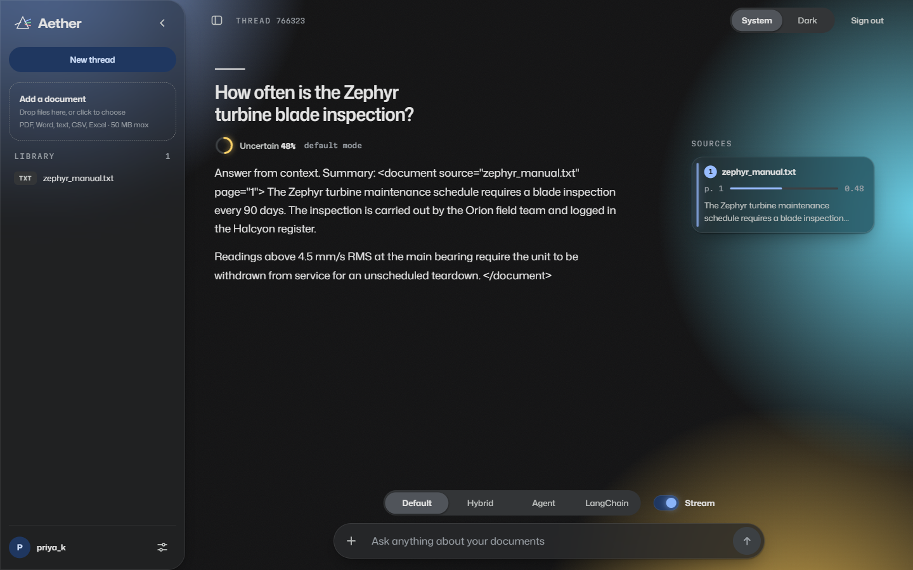

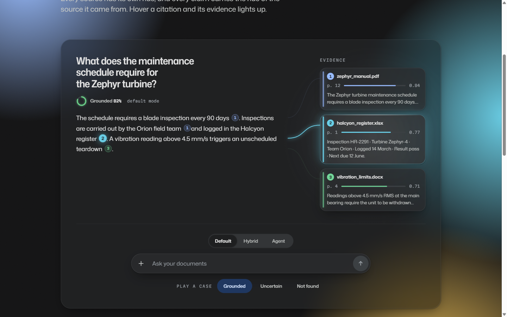

## The idea

Aether was the name for the medium light was once thought to travel through, so the interface is built on light.

A question is white light. Retrieval is the prism. The answer comes out as a spectrum: every source has its own hue, and every claim carries the hue of the source it came from. The one thing a person should remember after using it is that they could see where each sentence came from.

## Principles

1. **Content is the light; chrome is glass.** Surfaces stay quiet. Only the answer and its evidence glow.
2. **Colour means something.** About 90% neutral, 8% primary blue, 2% spectrum. Status colours never appear without a label or an icon.
3. **Everything responds.** Glass catches the pointer, controls move on springs, type changes weight and width with state.
4. **Calm at rest.** Nothing animates while idle. The background moves only when the app's state changes.
5. **Preferences are honoured.** Reduced motion and reduced transparency both have a designed fallback, and text contrast is at least 4.5:1.

## Colour

The method is Google's: neutral surfaces stacked by tone instead of shadow, one primary, and a small set of roles that each have a guaranteed readable "on" colour. Light and dark come from the same roles through `light-dark()`.

| Role | Light | Dark | Used for |
|---|---|---|---|
| `--p-bg` | `#f8fafd` | `#131314` | The page |
| `--p-surface` to `--p-surface-4` | `#ffffff` to `#dde3ea` | `#1e1f20` to `#3c4043` | Elevation by tone |
| `--p-ink`, `--p-ink-2`, `--p-ink-3` | `#1f1f1f`, `#444746`, `#5f6368` | `#e3e3e3`, `#c4c7c5`, `#9aa0a6` | Three levels of emphasis |
| `--p-primary` | `#1a73e8` | `#8ab4f8` | The one colour that means "act" |
| `--p-ok`, `--p-warn`, `--p-bad` | green, amber, red | lighter tints | Grounded, uncertain, failed |
| `--p-s1` to `--p-s5` | five hues at one lightness | the same hues, lighter | One per source |

The five source hues share one lightness and nearly one chroma (defined in OKLCH), so no source looks more important than another. They appear only as light: a citation chip, the edge of a source card, a thread. The full spectrum appears together in exactly one place, the rim of the composer while the model is working.

## Type

- **Mona Sans** (variable weight 200–900 and width 75–125) carries the interface and the answers. Display text runs wide and light; dense labels run narrow and heavier. Selected controls gain weight instead of changing colour.
- **Martian Mono** carries numbers: pages, scores, timings.
- Both are open-licensed (SIL OFL 1.1) and bundled in `frontend/src/design/fonts/`, so the app makes no font request to a third party.

## Material

One material, optical glass: a translucent pane with a hairline edge. A highlight on that edge and a soft glint inside follow the pointer, the way real glass catches light. While the model works, the composer's edge becomes a slowly turning spectrum.

## Components

| Component | File | Behaviour |
|---|---|---|
| `PrismRoot` | `prism.tsx` | Sets the theme and wires pointer light |
| `AmbientField` | `prism.tsx` | Corner light that tightens while retrieving and relaxes when answered |
| `Aperture` | `prism.tsx` | The composer: widens on focus, glows while busy, Send morphs into Stop |
| `Lens` | `prism.tsx` | One sliding control for a single choice; arrow keys move it |
| `ClarityRing` | `prism.tsx` | Confidence as optical clarity: sharp when grounded, diffuse when uncertain, hollow when refused |
| `Cite` | `prism.tsx` | A citation marker in the hue of its source |
| `SourceCard` | `prism.tsx` | Evidence in the margin: file, where it sits (`placeOf`: the page of a PDF, else "passage 3 of 42"), score and passage |
| `Threads` | `prism.tsx` | Lines of light from each citation to its source, routed through the gutter. Given `drawn`, a page can draw them one after another |
| `Switch` | `prism.tsx` | A toggle whose knob is a point of light |
| `Field` | `prism.tsx` | A text field: the label lifts on focus and the line under it splits into the spectrum |
| `HoldButton` | `prism.tsx` | For actions that cannot be undone: nothing happens unless the press is held |
| Library row remove | `Sidebar.tsx`, `app.css` (`.x-doc__remove`) | For removing one document, in a row too small for a hold: a quiet cross that shows with the row; one click arms it ("Remove?", in the status red), a second confirms; it disarms after four seconds or when focus leaves |
| Toasts | `ToastContainer.tsx`, `prism.css` (`.p-toasts`) | Short signals at the foot of the page, 4 s each, one message once. In the workspace they sit just above the dock (`--p-toast-lift`, set by `ChatComposer` to the dock's height), so they never cover the question box |
| `Dialog` | `prism.tsx` | A modal sheet: Escape and a click outside close it, Tab stays inside, focus returns afterwards, and the page behind it is inert while it is open (live regions excepted, so toasts are still heard) |
| `DemoBench` | `DemoBench.tsx` | The self-playing demonstration with sample data. In the design lab only: the start page shows no sample data (13 Oct 2026) |
| `WhyDifferent` | `components/landing/WhyDifferent.tsx`, `app.css` (`.l-why`) | The start page's argument, in the shape of an answer: five claims, each with a citation marker, and in the margin the evidence for each, joined by threads. The threads lead: they are bolder here than anywhere else (`.l-why .p-threads`), and the first time the claims scroll into view they are traced once, one claim at a time, each line drawn from its claim to its evidence while the pair is lit; then all five stay and nothing moves again (rule 4: it answers the reader's scroll and does not loop). Pointing at a claim, its marker or its card takes over at any moment, lights the pair and quietens the rest. With reduced motion the lines are simply there; on a narrow screen the evidence is below the claims, there are no lines and nothing is traced. The cards say what in the product backs the claim; nothing is sample data |
| Search in | `ScopePicker.tsx`, `app.css` (`.x-scope`) | In the dock beside the answer mode, once there are two documents or more: a pill that says what a question searches ("All documents", a title, "Every Word file", "2 documents"), tonal once a choice is made. It opens a glass panel above the dock: All documents, each kind of file there is, and every document by its title with its file name under it. Escape or a click outside closes it. The choice holds for the questions that follow |
| Searched note | `MessageBubble.tsx` (`ScopeNote`), `app.css` (`.x-scope-note`) | Under an answer's status, in hint type, when it searched less than everything: which documents and why ("chosen in Search in", "named in your question"), so a wrong guess is seen and can be put right |
| Source in its document | `SourceViewer.tsx`, `app.css` (`.x-viewer`, `.x-margin__open`) | A source card pinned open offers "Show on p. 20" (a PDF) or "Show in the document" (anything else), as a tonal button under it, when the source says which document and passage it is. A wide `Dialog` (880 px): for a PDF whose file is kept, the page drawn by pdf.js on a white sheet (white in both themes, as printed) with the passage's lines marked in the source's hue, a line saying whether it could be marked, and "Open the whole PDF"; for any other document, the passage among the ones either side, the cited one marked with the hue's edge. The page scales with the dialog and is drawn again when the dialog grows much wider |
| Share sheet | `ShareDialog.tsx`, `app.css` (`.x-share`) | Opened by Share in the workspace's top bar (an icon alone below 420 px). A `Dialog` that says who can read what, makes the link, shows it in a read-only `Field`, copies it and withdraws it |
| Shared page | `components/shared/SharedPage.tsx`, `app.css` (`.h-`) | `/shared/<token>`: one conversation, read only, for anyone who has its link. The start page's top bar without the sign-in button, then the conversation as the workspace draws it (question, clarity, answer, sources) with no rating and no composer, and one line inviting the reader to ask their own documents |
| Thread list | `Sidebar.tsx`, `app.css` (`.x-thread`) | The rail's conversations, newest first, by first question and time or date; each is a link to `/chat/<id>`. The open one is `aria-current="page"` and gains weight on a surface tone, as a selected control does, never a colour of its own |
| Citation chips in an answer | `MessageBubble.tsx`, `citations.ts`, `Cite` | When the sources carry a number, each `[n]` in the answer is a `Cite` in source n's hue; hovering or focusing either the chip or its card lights both, and the chip's click or Enter pins the card open. Otherwise the answer is shown as written |
| Answer rating | `MessageBubble.tsx`, `app.css` (`.x-rate`) | Two quiet icon buttons under a saved answer, Helpful and Not helpful; the chosen one is `aria-pressed` in the tonal fill, and pressing it again takes it back |
| Tools used | `MessageBubble.tsx`, `app.css` (`.x-tools`) | A labelled row above an agent's answer, one quiet chip per tool |
| Retry row | `ChatComposer.tsx`, `app.css` (`.x-retry`) | Above the composer when a reply failed or was stopped: the word first ("Failed." in the status red, or "Stopped."), then what happened, and Retry. The question is back in the composer |
| Upload stage | `Sidebar.tsx` (the drop zone) | "Sending" while the file goes up, then "Reading" while the server splits it, with the working beam; a polite live region |
| Cost line | `MessageBubble.tsx`, `app.css` (`.x-usage`) | One quiet line in mono under a new answer, "4.2 s, 1,240 tokens", in the third ink. It is a native disclosure: opened, it lists the stages in the order they ran, each with its seconds and tokens in and out, or "no model call". Tokens are never priced. An answer read back after a reload has no line |
| Agent steps | `MessageBubble.tsx`, `app.css` (`.x-steps`) | Above an agent's answer, under the eyebrow "Steps": each tool call numbered in mono, the tool as the tools row's chip, what it was asked in the first ink and the start of what it returned in the third. It takes the tools row's place; an answer read back after a reload keeps the tools row |
| Thread row controls | `Sidebar.tsx`, `app.css` (`.x-thread-row`) | Rename and Delete on each thread: the library row's quiet controls, showing with the row. Rename edits the name in place (Enter or leaving the field keeps it, Escape gives up, and focus goes back to Rename); Delete is armed by a first click ("Delete?", in the status red) and confirmed by a second, and disarms as Remove does. The whole row takes the open thread's tone |
| Sign out everywhere | `SettingsModal.tsx` (General) | A settings row like Clear conversation: what it does in one sentence, and a tonal button |

Some interaction ideas (the light-point toggle, the floating-label field, hold to confirm) were prompted by browsing the open-source gallery at uiverse.io. They were written from scratch in this language; no code was copied.

Two moments are choreographed. **Development:** streamed words arrive blurred and settle into focus. **Dispersion:** when an answer completes, its source cards leave it one by one and the threads draw after they land.

## Layout

The answer sits on the left and its evidence in the right margin, like notes in a scholarly book. Below 900 px, in the workspace and in the start page's claims, the margin moves under the answer and the threads are not drawn; below 900 px the library rail also becomes a drawer.

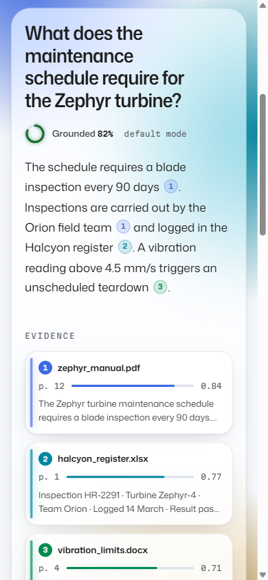

## Added in Sprint 6

Taken with Playwright against the built app, its API answered with sample data, at 1280 px and 375 px.

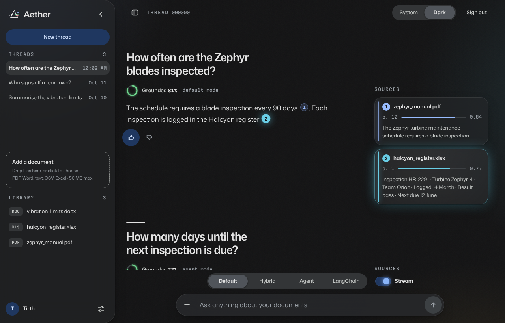

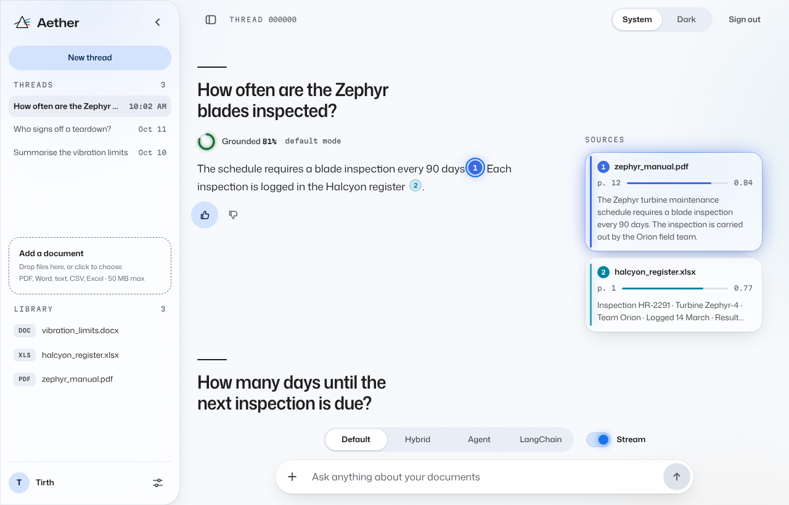

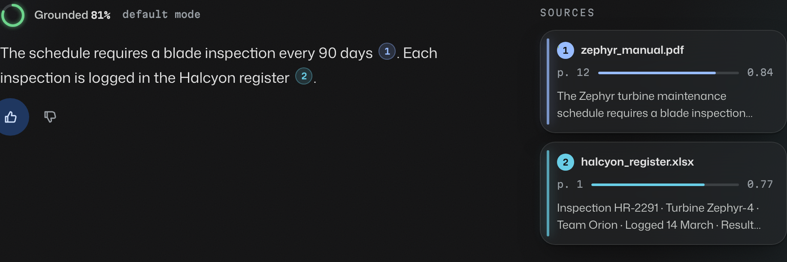

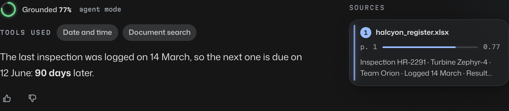

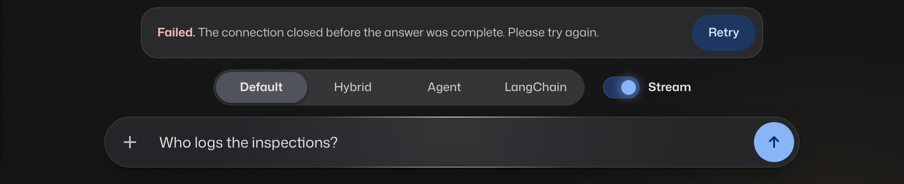

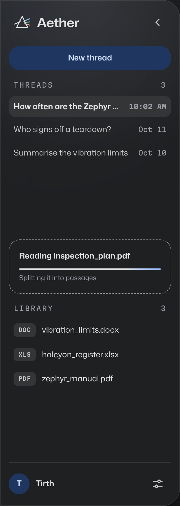

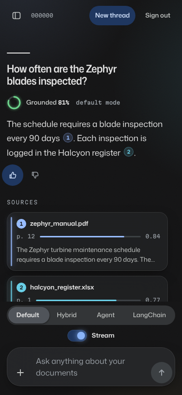

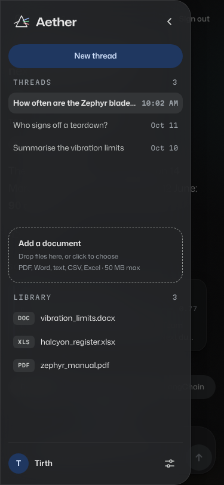

## Added in Sprint 8

Taken with Playwright against the built app and the backend with fake models (`backend/tests/e2e_server.py`), at 1280 px and 375 px. The answers are the fake model's, which quotes the passages it was given.

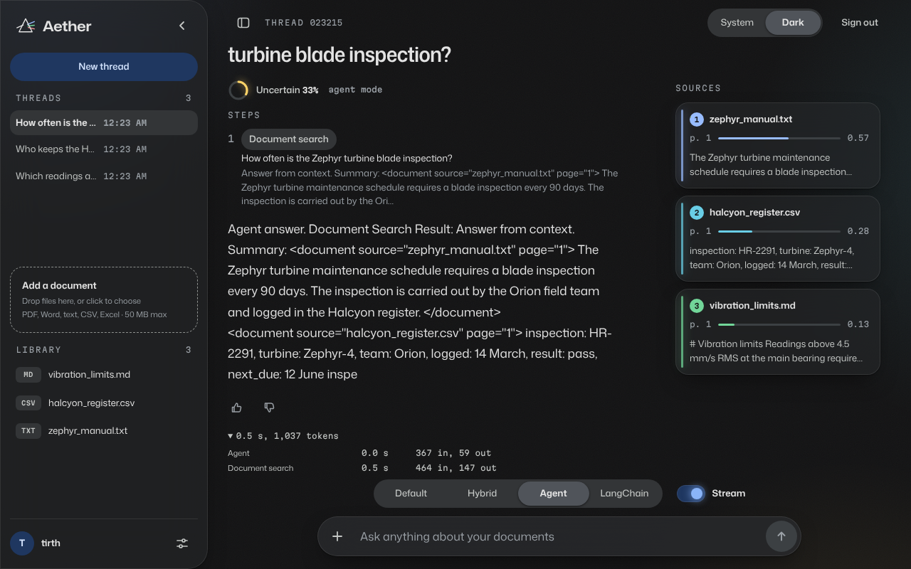

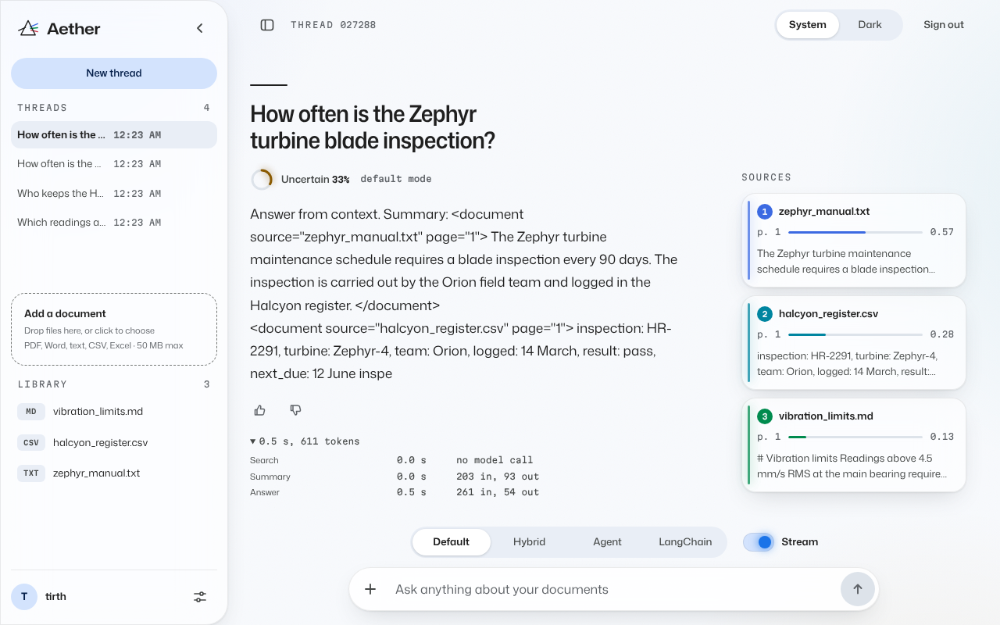

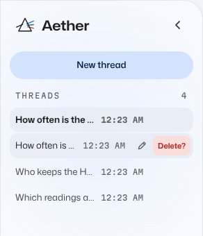

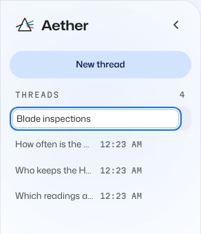

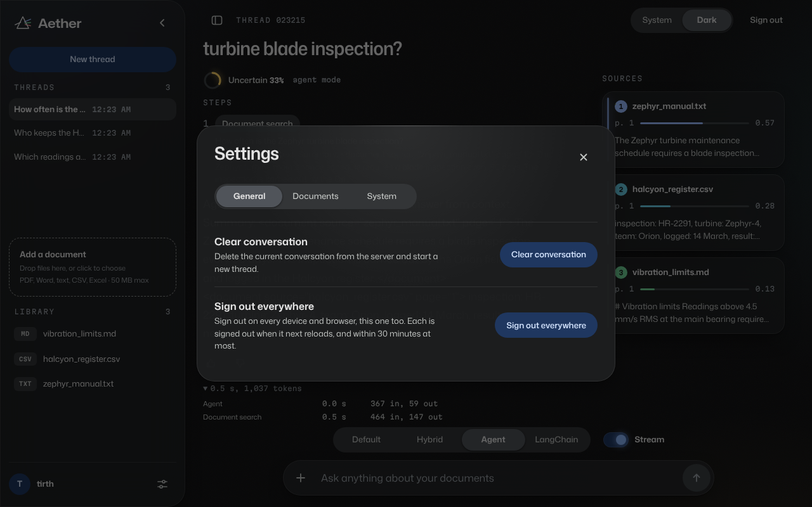

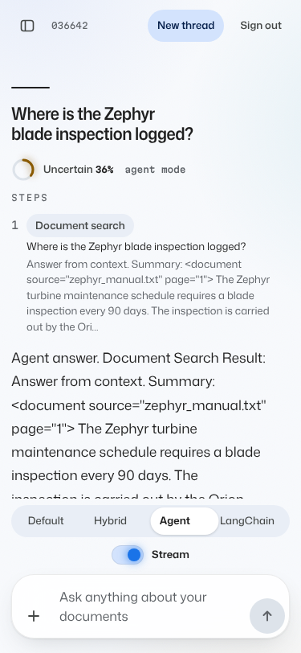

## Rules for building with it

- Every Prism screen is wrapped in `PrismRoot`; all tokens are scoped to `.prism` and prefixed `--p-`.
- Do not animate anything behind glass while idle, and do not put a blend mode on a full-screen layer. Both were measured as expensive during the first build.
- Status is never colour alone: pair it with a word.
- Use the spectrum for sources only.
- A modal sheet is a `Dialog`: the page behind it is inert while it is open.
- Every screen fits from 360 px wide without scrolling sideways; the browser journey checks it.

## What comes next

1. Merge with the Sprint 2 test suite: two assertions in its chat test describe the old markup (the mode control is now a radio group, and a source card shows a preview of its passage).
2. A screen-reader pass with a real screen reader. Sprint 6 checked the keyboard path of the settings sheet in the browser journey, and axe (no serious or critical violation) and Lighthouse (accessibility 100) on the main screens; nobody has yet used the app with NVDA or VoiceOver.
3. Threads (the lines of light) in the real chat. Since Sprint 6 an answer written from numbered chunks (`AETHER_ANSWER_FROM=chunks`) ties each `[n]` to its source by hue, hover and focus; the lines themselves are drawn only on the start page, between its claims and their evidence. The server's default is still the summary mode, whose answers cite nothing.
4. Done in Sprint 6 (decision 11): Stop closes the stream, a stream closed early saves no turn, and no cancel route was added.
