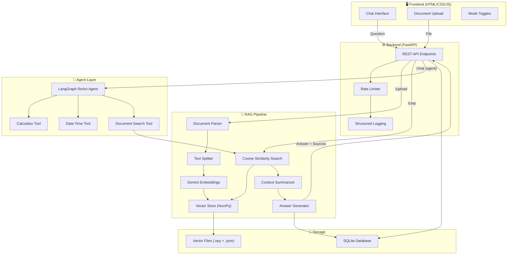
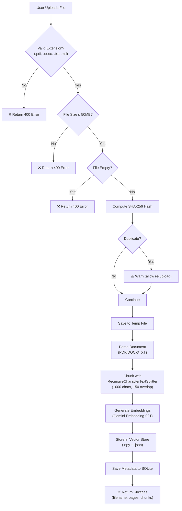
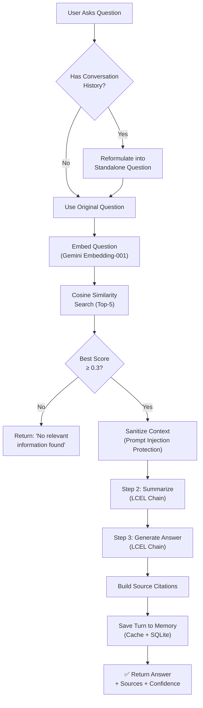
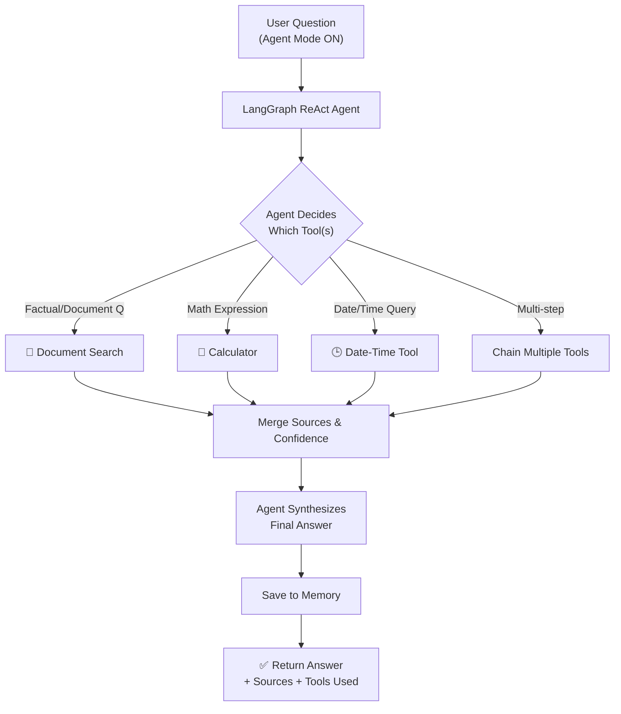

# Aether AI — RAG-Based Knowledge Assistant Chatbot

---

> **College Name:** Devang Patel Institute of Advance Technology and Research
> **Department:** Department of Computer Science
> **Academic Year:** 2026–2027
> **Semester:** 7th Semester
> **Subject:** CSE402 — Summer Internship-I
>
> **Submitted By:** Tirth Ganatra
> **Enrollment No.:** 23DCS027
>
> **Guided By:** Ms. Binal Kaka

---

## Abstract

**Aether AI** is a full-stack, Retrieval-Augmented Generation (RAG) knowledge assistant chatbot that enables users to upload documents (PDF, DOCX, TXT, Markdown) and receive precise, source-cited answers powered by Google's Gemini large language model. Unlike conventional chatbots that rely solely on pre-trained knowledge, Aether AI grounds every answer in the user's own uploaded documents, dramatically reducing hallucinations and improving factual accuracy.

The system implements a three-step sequential chain pipeline — **Retrieve → Summarize → Generate** — using LangChain Expression Language (LCEL). User-uploaded documents are parsed, chunked using `RecursiveCharacterTextSplitter`, embedded via `Gemini Embedding-001`, and stored in a lightweight, pure-Python NumPy/JSON vector store. When a question is asked, the system performs cosine similarity search to retrieve the top-K most relevant chunks, summarizes them for focus, and generates a final answer with confidence scoring and source citations.

Beyond basic RAG, the project implements several advanced features: **multi-turn conversation memory** (SQLite-backed), **prompt injection protection**, **confidence thresholding**, **real-time token-by-token streaming** via Server-Sent Events (SSE), a **LangGraph-powered ReAct agent** with tool-chaining capabilities (calculator, date-time, document search), and a **dual-pipeline architecture** offering both a custom RAG engine and a LangChain-native alternative. The frontend is a modern, dark-themed single-page chat interface with a sidebar for document management, mode toggles, and expandable source citation cards.

**Keywords:** RAG, LLM, LangChain, Gemini, Vector Embedding, Cosine Similarity, Chatbot, NLP, FastAPI, LCEL

---

## Index

| Chapter No. | Chapter Title | Page No. |
|:-----------:|---|:---:|
| — | Abstract | 1 |
| 1 | Project Definition | 2 |
| 2 | Description | 3 |
| 3 | Software and Hardware Requirements | 6 |
| 4 | Major Functionality | 7 |
| 5 | Flow Chart | 10 |
| 6 | Screenshots of Project Output | 12 |
| 7 | Limitations of Project | 15 |
| 8 | Outcome | 16 |
| 9 | Future Enhancement | 17 |
| 10 | References | 18 |

---

## Chapter 1: Project Definition

### 1.1 Problem Statement

Organizations and individuals deal with ever-growing volumes of unstructured documents — research papers, manuals, reports, legal contracts, and notes. Extracting specific information from these documents is time-consuming and error-prone. General-purpose AI chatbots (like ChatGPT) cannot answer questions about **private, user-specific documents** because they are limited to their pre-trained knowledge and have no access to the user's files.

### 1.2 Proposed Solution

**Aether AI** addresses this problem by building a **Retrieval-Augmented Generation (RAG) chatbot** that:

1. Allows users to **upload their own documents** (PDF, DOCX, TXT, Markdown).
2. **Parses and chunks** documents into smaller, semantically meaningful text segments.
3. **Generates vector embeddings** for each chunk using Google's Gemini Embedding model.
4. **Stores embeddings** in a disk-persisted vector store for efficient similarity search.
5. Upon receiving a user question, **retrieves the most relevant chunks** via cosine similarity.
6. **Summarizes** the retrieved context to remove noise and redundancy.
7. **Generates a precise, grounded answer** using the Gemini LLM, citing the exact sources.

### 1.3 Objectives

- Build a functional, end-to-end RAG pipeline from document ingestion to answer generation.
- Implement multi-turn conversation memory so users can ask follow-up questions naturally.
- Provide confidence scoring so users know how reliable each answer is.
- Protect against prompt injection attacks embedded within uploaded documents.
- Support multiple answer modes: standard RAG, LangChain RAG, and agentic tool-chaining.
- Deliver a polished, modern web interface for a seamless user experience.
- Implement production-grade features: rate limiting, structured logging, and streaming responses.

### 1.4 Scope

The project covers the complete lifecycle of a RAG chatbot system:
- **Document ingestion** (upload, parse, chunk, embed, store)
- **Question answering** (retrieve, summarize, generate, cite)
- **Conversation management** (multi-turn memory, session handling)
- **Tool-augmented reasoning** (calculator, date-time, multi-step agent)
- **Production features** (logging, rate limiting, error handling, duplicate detection)
- **Web interface** (modern chat UI with source cards and mode toggles)

---

## Chapter 2: Description

### 2.1 System Architecture Overview

Aether AI follows a **client-server architecture** with a clear separation between the frontend and backend:

| Layer | Technology | Purpose |
|---|---|---|
| **Frontend** | HTML/CSS/JavaScript (single-file SPA) | Chat interface, document upload, mode toggles |
| **API Server** | FastAPI (Python) + Uvicorn | REST API endpoints, CORS, rate limiting |
| **RAG Engine** | Custom Python + LangChain LCEL | Document parsing, chunking, embedding, retrieval, generation |
| **Vector Store** | NumPy `.npy` + JSON metadata | Disk-persisted vector embeddings for cosine similarity search |
| **Database** | SQLite (WAL mode) | Conversation history, document metadata, deduplication |
| **LLM Provider** | Google Gemini 2.5 Flash Lite | Text generation, summarization, question reformulation |
| **Embedding Model** | Gemini Embedding-001 | 768-dimensional dense vector embeddings |
| **Agent Framework** | LangGraph (ReAct pattern) | Multi-step tool-chaining agent |

### 2.2 Backend Modules

The backend is organized into six well-defined Python modules:

#### 2.2.1 `main.py` — FastAPI Application (326 lines)
The central application file that defines the REST API. It exposes the following endpoints:

| Endpoint | Method | Purpose |
|---|---|---|
| `/` | GET | Serve the static chat UI |
| `/upload` | POST | Upload and ingest a document |
| `/chat` | POST | Ask a question (standard response) |
| `/chat/stream` | POST | Ask a question (streaming SSE response) |
| `/documents` | GET | List all ingested documents |
| `/documents` | DELETE | Clear all documents from the vector store |
| `/session/clear` | POST | Clear conversation memory for a session |
| `/health` | GET | Health check with uptime, document and conversation stats |

Includes rate limiting (30 requests/minute for chat, 10/minute for uploads), file validation (type, size, empty-check), SHA-256 duplicate detection, and comprehensive error handling.

#### 2.2.2 `rag_engine.py` — Core RAG Pipeline (474 lines)
The heart of the system. Implements:
- **Document parsers** for PDF (`pypdf`), DOCX (`python-docx`), and TXT/MD files.
- **`RecursiveCharacterTextSplitter`** (1000-char chunks, 150-char overlap).
- **`SimpleVectorStore`** — a pure-Python vector store using NumPy arrays for embeddings and JSON for metadata. Supports `add()`, `search()` (cosine similarity), `clear()`, and `all_sources()`.
- **Three-step sequential chain**: Retrieve → Summarize → Generate, each composed using LCEL (`prompt | model | parser`).
- **Conversation memory** (`ConversationMemory` class) backed by SQLite, with in-memory caching for fast reads.
- **Prompt injection protection** — regex-based sanitization of 11 known injection patterns.
- **Confidence scoring** — average cosine similarity of retrieved chunks, with a 0.3 threshold.
- **Context-aware question reformulation** — follow-up questions are rephrased into standalone queries.

#### 2.2.3 `rag_langchain.py` — LangChain RAG Pipeline (352 lines)
A parallel, alternative RAG implementation using LangChain's official components:
- **LangChain Document Loaders**: `PyPDFLoader`, `Docx2txtLoader`, `TextLoader` (replacing manual parsing).
- **LangChain Text Splitters**: `RecursiveCharacterTextSplitter` with chunk positioning metadata.
- **LCEL Refactor**: The entire pipeline is composed using the `|` (pipe) operator: `prompt | model | parser`.
- Shares the same vector store and memory as the original engine — no data duplication.

#### 2.2.4 `agent.py` — Multi-Step Agent (139 lines)
Implements a **LangGraph ReAct agent** that can chain multiple tools together to answer complex questions:
- Uses `create_react_agent()` from LangGraph's prebuilt module.
- Wraps three tools in closures for metadata tracking: `document_search_wrapper`, `calculator_wrapper`, `datetime_wrapper`.
- Injects conversation history so the agent understands context across turns.
- Deduplicates sources when the agent calls document search multiple times.
- Reports which tools were used (displayed as UI badges).

#### 2.2.5 `tools.py` — LangChain Tools (165 lines)
Defines two specialized tools:
- **Calculator Tool**: Safe mathematical expression evaluation using Python's `ast` module. Supports arithmetic operators, `sqrt()`, `sin()`, `cos()`, `log()`, `pi`, `e`, etc. Prevents code injection via AST whitelist validation.
- **Date-Time Tool**: Returns current date/time and computes date differences. Uses an LLM chain to interpret natural language date queries (e.g., "how many days until December 31?").

#### 2.2.6 `database.py` — SQLite Persistence Layer (150 lines)
Manages two tables:
- **`conversations`**: Stores every Q&A turn with session ID, confidence, mode, and timestamp. Supports retrieval, clearing, and statistics.
- **`documents`**: Tracks uploaded document metadata including filename, file hash (SHA-256), pages, chunks, size, and timestamp. Enables duplicate detection.
- Uses WAL journal mode for concurrent read performance and thread-safe write locking.

#### 2.2.7 `logger.py` — Production Logging (67 lines)
Implements structured, rotating log files:
- `logs/requests.log` — all chat queries and responses.
- `logs/uploads.log` — document upload events.
- `logs/errors.log` — all errors across the application.
- Each file is capped at 5MB with 5 backup copies (RotatingFileHandler).

### 2.3 Frontend

The frontend is a **single-file SPA** (`backend/static/index.html`, 926 lines) served directly by FastAPI. It features:

- **Dark-themed modern UI** with the Inter font family and a curated color palette.
- **Sidebar** with document upload (drag-to-click), document list, and mode toggles (Agent, LangChain, Streaming).
- **Chat area** with user/bot message bubbles, animated thinking indicator, and a fixed input bar.
- **Source citation cards** — expandable cards showing the source document, page number, relevance score, and snippet.
- **Confidence badges** — color-coded (green/yellow/red) badges showing answer reliability.
- **Tool usage badges** — indicate which tools the agent used (📄 document_search, 🧮 calculator, 🕒 datetime).
- **Session management** — generate unique session IDs, start new threads, and clear history.
- **Streaming support** — token-by-token rendering using the ReadableStream API and SSE.

### 2.4 Technology Stack Summary

| Category | Technology |
|---|---|
| Backend Framework | FastAPI 0.115+ with Uvicorn |
| LLM | Google Gemini 2.5 Flash Lite |
| Embedding Model | Gemini Embedding-001 |
| RAG Framework | LangChain 0.3+, LangChain Community, LangChain Google GenAI |
| Agent Framework | LangGraph 0.4+ (ReAct pattern) |
| Vector Storage | NumPy + JSON (disk-persisted) |
| Database | SQLite 3 (WAL mode) |
| Document Parsing | pypdf, python-docx, docx2txt |
| Text Splitting | LangChain RecursiveCharacterTextSplitter |
| Rate Limiting | SlowAPI |
| Search Fallback | DuckDuckGo Search |
| Frontend | Vanilla HTML/CSS/JS (single-page SPA) |
| Dev Server | Vite (for React-based frontend, optional) |

---

## Chapter 3: Software and Hardware Requirements

### 3.1 Software Requirements

| Component | Requirement |
|---|---|
| **Operating System** | Windows 10/11, macOS, or Linux |
| **Python** | Python 3.10 or higher |
| **Node.js** (optional) | Node.js 18+ (only if using the Vite/React frontend) |
| **Web Browser** | Google Chrome, Firefox, Edge, or Safari (latest versions) |
| **Google API Key** | A valid Google Gemini API key (set in `.env`) |

**Python Packages (from `requirements.txt`):**

| Package | Version | Purpose |
|---|---|---|
| `fastapi` | ≥ 0.115.0 | REST API framework |
| `uvicorn[standard]` | ≥ 0.32.0 | ASGI server |
| `python-multipart` | ≥ 0.0.12 | File upload handling |
| `langchain` | ≥ 0.3.0 | RAG framework core |
| `langchain-google-genai` | ≥ 2.0.0 | Gemini LLM/Embedding integration |
| `langchain-text-splitters` | ≥ 0.3.0 | Document chunking |
| `langchain-community` | ≥ 0.3.0 | Community document loaders |
| `langgraph` | ≥ 0.4.0 | ReAct agent framework |
| `pypdf` | ≥ 4.3.1 | PDF text extraction |
| `python-docx` | ≥ 1.1.0 | DOCX parsing |
| `docx2txt` | ≥ 0.8 | DOCX text extraction (LangChain loader) |
| `python-dotenv` | ≥ 1.0.1 | Environment variable management |
| `numpy` | ≥ 1.24.0, < 2.0.0 | Vector operations & cosine similarity |
| `duckduckgo-search` | ≥ 5.0.0 | Web search fallback |
| `slowapi` | ≥ 0.1.9 | API rate limiting |

### 3.2 Hardware Requirements

| Component | Minimum | Recommended |
|---|---|---|
| **Processor** | Intel Core i3 / AMD Ryzen 3 | Intel Core i5 / AMD Ryzen 5 or better |
| **RAM** | 4 GB | 8 GB or more |
| **Storage** | 500 MB free space | 2 GB+ (for large document stores) |
| **Internet** | Required (for Gemini API calls) | Stable broadband connection |
| **GPU** | Not required | Not required (all inference is cloud-based) |

> [!NOTE]
> Since all LLM inference and embedding generation is performed by the Google Gemini cloud API, no local GPU is needed. The vector store uses NumPy for cosine similarity, which runs efficiently on CPU.

---

## Chapter 4: Major Functionality

### 4.1 Document Ingestion Pipeline

The system accepts documents in four formats: **PDF**, **DOCX**, **TXT**, and **Markdown**.

**Process:**
1. **Upload** — User selects a file via the sidebar upload zone.
2. **Validation** — Server checks file extension, size (max 50MB), and non-empty content.
3. **Deduplication** — SHA-256 hash is computed and checked against previously uploaded documents in SQLite.
4. **Parsing** — File is parsed into page-level `Document` objects:
   - PDF: `pypdf.PdfReader` extracts text page-by-page.
   - DOCX: `python-docx` extracts all paragraphs.
   - TXT/MD: Direct file read with UTF-8 encoding.
5. **Chunking** — `RecursiveCharacterTextSplitter` splits documents into 1000-character chunks with 150-character overlap, using hierarchical separators (`\n\n`, `\n`, `. `, ` `).
6. **Embedding** — Each chunk is embedded into a 768-dimensional vector using `Gemini Embedding-001`, processed in batches of 100.
7. **Storage** — Vectors are stored as a NumPy `.npy` file; metadata (text, source, page, chunk_id) is stored as a JSON file.
8. **Recording** — Document metadata is saved to the SQLite `documents` table.

### 4.2 RAG Query Pipeline (Retrieve → Summarize → Generate)

The query pipeline follows a **three-step sequential chain**:

**Step 1 — Retrieve:**
- The user's question is embedded using `Gemini Embedding-001`.
- Cosine similarity search is performed against all stored vectors.
- The top-5 most relevant chunks are returned with their similarity scores.
- If the best similarity score is below 0.3 (confidence threshold), the system refuses to answer rather than hallucinate.

**Step 2 — Summarize:**
- The retrieved chunks are wrapped in `<document>` tags (with source and page metadata).
- Prompt injection patterns are sanitized from the chunks.
- An LCEL chain (`SUMMARIZE_PROMPT | llm | StrOutputParser`) condenses the raw chunks into a focused summary relevant to the question.

**Step 3 — Generate:**
- The summarized context, conversation history, and original question are passed to the final LCEL chain (`RAG_PROMPT | llm | StrOutputParser`).
- The LLM generates a precise answer grounded only in the provided context.
- Source citations (document name, page number, snippet, relevance score) are attached to the response.

### 4.3 Multi-Turn Conversation Memory

- Each conversation is identified by a unique `session_id`.
- Every Q&A turn is stored in both an in-memory cache (for fast access) and the SQLite `conversations` table (for persistence across server restarts).
- Up to 10 previous turns are maintained per session.
- Follow-up questions (e.g., "What about its limitations?") are automatically reformulated into standalone queries using the Gemini LLM, so the vector search returns relevant results.

### 4.4 Agent Mode (Multi-Step Tool Chaining)

When Agent Mode is enabled, the system uses a **LangGraph ReAct agent** that can:
- **Search documents** — queries the RAG pipeline for factual, document-grounded answers.
- **Calculate math** — evaluates mathematical expressions safely via AST-based parsing.
- **Get date/time** — returns current date/time or computes date differences.
- **Chain tools** — the agent can call multiple tools in sequence (e.g., search a document, then calculate a value from the result).

### 4.5 Streaming Responses (SSE)

When Streaming Mode is enabled, the answer is delivered **token-by-token** using Server-Sent Events:
- The server sends each word as a `{ type: "token", content: "..." }` event.
- After all tokens, a `{ type: "done", sources: [...], confidence: 0.xx }` event delivers metadata.
- The frontend renders tokens in real-time using the `ReadableStream` API.

### 4.6 Dual RAG Pipeline (Original vs. LangChain)

The system provides two parallel RAG implementations:

| Feature | Original (`rag_engine.py`) | LangChain (`rag_langchain.py`) |
|---|---|---|
| Document Loaders | Custom parsers (pypdf, python-docx) | LangChain loaders (PyPDFLoader, Docx2txtLoader) |
| Text Splitting | RecursiveCharacterTextSplitter | RecursiveCharacterTextSplitter |
| Vector Store | Shared SimpleVectorStore | Shared SimpleVectorStore |
| Chain Style | LCEL (`prompt \| model \| parser`) | LCEL (`prompt \| model \| parser`) |
| Memory | Shared ConversationMemory | Shared ConversationMemory |

Both pipelines share the same vector store and memory, so documents uploaded via one pipeline are accessible from the other.

### 4.7 Prompt Injection Protection

The system defends against prompt injection attacks embedded in uploaded documents. Eleven regex patterns detect common injection phrases (e.g., "ignore all previous instructions", "you are now a...", "reveal your system prompt") and replace them with `[REDACTED: injection attempt]`. Additionally, retrieved context is wrapped in `<document>` tags and the system prompt explicitly instructs the LLM to treat document content as data, not commands.

### 4.8 Production Features

| Feature | Implementation |
|---|---|
| **Rate Limiting** | SlowAPI: 30 req/min (chat), 10 req/min (upload) |
| **Structured Logging** | RotatingFileHandler: `requests.log`, `uploads.log`, `errors.log` (5MB, 5 backups) |
| **Error Handling** | Try-catch at every layer with structured HTTP error responses |
| **Duplicate Detection** | SHA-256 file hashing with SQLite lookup |
| **Health Check** | `/health` endpoint reporting uptime, document count, and conversation stats |
| **CORS** | Configured for `localhost:5173` and `localhost:8000` |

---

## Chapter 5: Flow Chart

### 5.1 Overall System Architecture

### 5.2 Document Ingestion Flow

### 5.3 RAG Query Flow

### 5.4 Agent Decision Flow

---

## Chapter 6: Screenshots of Project Output

> [!NOTE]
> Replace each placeholder below with an actual screenshot from the running application.

---

### Screenshot 1: Welcome Screen

**Description:** The initial state of the Aether AI chat interface. The dark-themed UI shows the sidebar with the upload zone, empty document list, and mode toggles (Agent, LangChain, Streaming). The main chat area displays the welcome message: "What do you want to know?" with the Aether AI logo.

`[Insert Screenshot: Welcome screen with sidebar and empty chat area]`

---

### Screenshot 2: Document Upload

**Description:** A user has uploaded a PDF document. The sidebar shows a green success notification: "✅ Successfully ingested 'document.pdf' (X chunks from Y page(s))." The document list now shows the uploaded file with a 📄 icon.

`[Insert Screenshot: Successful document upload with notification]`

---

### Screenshot 3: Standard Chat — Question & Answer

**Description:** A user asks a question about the uploaded document. The bot responds with a formatted answer, showing a green "High · 87%" confidence badge. Below the answer, expandable source citation cards show the source file, page number, and relevance score.

`[Insert Screenshot: Chat with answer, confidence badge, and source cards]`

---

### Screenshot 4: Source Citation Card Expanded

**Description:** The user has clicked on one of the source citation cards. The card expands to reveal the actual text snippet retrieved from the document, providing transparency into which part of the document the answer was based on.

`[Insert Screenshot: Expanded source card showing snippet text]`

---

### Screenshot 5: Agent Mode — Multi-Tool Usage

**Description:** Agent Mode is enabled (toggle ON in sidebar). The user asks a question that requires both document search and calculation. The response shows multiple tool badges: "📄 document_search" and "🧮 calculator", indicating the agent chained these tools together.

`[Insert Screenshot: Agent mode with multiple tool badges]`

---

### Screenshot 6: Streaming Response

**Description:** Streaming Mode is enabled. The answer is being rendered token-by-token in real-time. The screenshot captures the mid-stream state where partial text is visible, demonstrating the live typing effect.

`[Insert Screenshot: Streaming response in progress]`

---

### Screenshot 7: Low Confidence Response

**Description:** The user asks a question that is not well-covered by the uploaded documents. The bot responds with a red "Low · 22%" confidence badge and a message indicating insufficient information in the documents.

`[Insert Screenshot: Low confidence answer with warning badge]`

---

### Screenshot 8: Health Check API Response

**Description:** The `/health` endpoint is accessed in a browser or API client (Postman/Thunder Client). The JSON response shows: server status, version, uptime, total documents, total chunks, total conversation turns, and active sessions.

`[Insert Screenshot: /health endpoint JSON response]`

---

### Screenshot 9: Multiple Documents Uploaded

**Description:** The sidebar document list shows multiple uploaded documents (e.g., a PDF, a DOCX, and a TXT file). This demonstrates the system's ability to handle multiple documents simultaneously and search across all of them.

`[Insert Screenshot: Sidebar with multiple documents listed]`

---

### Screenshot 10: New Thread / Session Clear

**Description:** The user clicks the "✦ New Thread" button in the top bar. The chat area resets to the welcome state, and the session label shows a new session ID. This demonstrates session management and conversation isolation.

`[Insert Screenshot: New thread with reset chat area]`

---

## Chapter 7: Limitations of Project

1. **Cloud Dependency:** The system requires a stable internet connection for all LLM inference and embedding generation, as it relies entirely on the Google Gemini cloud API. It cannot function offline.

2. **No Semantic Search Across Documents:** While the vector store indexes all uploaded documents, there is no document-level filtering or scoping. A question always searches across all uploaded documents, which can introduce noise if many unrelated documents are uploaded.

3. **Single-User Design:** The current architecture does not implement user authentication or multi-tenant isolation. All users on the same server instance share the same vector store and document pool.

4. **Limited Document Format Support:** Only PDF, DOCX, TXT, and Markdown files are supported. Formats like XLSX (Excel), PPTX (PowerPoint), HTML, CSV, and scanned/image-based PDFs (requiring OCR) are not supported.

5. **No OCR Capability:** Scanned PDFs or image-based documents cannot be processed. The system relies on text extraction, so documents without embedded text will yield no results.

6. **Vector Store Scalability:** The pure-Python NumPy vector store performs a brute-force cosine similarity search across all vectors. For very large document collections (tens of thousands of chunks), this linear scan becomes slow compared to approximate nearest neighbor (ANN) solutions like FAISS or Pinecone.

7. **No Real-Time Document Updates:** Documents must be re-uploaded and re-indexed if their content changes. The system does not watch for file modifications or support incremental updates.

8. **Rate Limiting per IP:** The rate limiter is based on IP address, which may be too restrictive in shared network environments (e.g., behind a corporate NAT) or too permissive when a single user bypasses it via multiple IP addresses.

9. **No Export or History Browse:** Users cannot export conversation history, search past conversations, or browse previous sessions through the UI.

10. **Fixed Chunk Parameters:** The chunk size (1000 characters) and overlap (150 characters) are hardcoded. Different document types might benefit from different chunking strategies (e.g., smaller chunks for code, larger for prose).

---

## Chapter 8: Outcome

### 8.1 Achieved Results

The Aether AI RAG Chatbot was successfully developed and achieves all core objectives:

1. **Functional End-to-End RAG Pipeline:** Users can upload documents and receive precise, source-cited answers in under 5 seconds (typical response time).

2. **High Answer Quality:** The three-step chain (Retrieve → Summarize → Generate) significantly improves answer quality over naive single-step retrieval by eliminating irrelevant context before generation.

3. **Transparent Source Attribution:** Every answer includes clickable source citation cards showing the exact document, page, relevance score, and text snippet — enabling users to verify answers against the original documents.

4. **Confidence Scoring:** The cosine similarity-based confidence scoring (with a 0.3 threshold) prevents the system from generating hallucinated answers when documents don't contain relevant information.

5. **Robust Conversation Memory:** Multi-turn follow-up questions are handled naturally through automatic question reformulation and SQLite-backed conversation history that survives server restarts.

6. **Agentic Capabilities:** The LangGraph ReAct agent successfully chains tools (document search + calculator + date-time) to answer complex, multi-step questions.

7. **Production-Grade Features:** Rate limiting, structured logging, error handling, duplicate detection, and a health check endpoint make the system suitable for deployment beyond a development prototype.

8. **Polished User Interface:** The dark-themed, modern chat interface provides a professional user experience with animated transitions, mode toggles, streaming responses, and expandable source cards.

### 8.2 Learning Outcomes

Through this project, the following concepts and technologies were studied and practically applied:

- **Retrieval-Augmented Generation (RAG)** architecture and pipeline design.
- **Vector embeddings** and **cosine similarity** for semantic search.
- **LangChain Expression Language (LCEL)** for composable AI pipelines.
- **LangGraph ReAct agents** for multi-step tool-chaining reasoning.
- **FastAPI** for building high-performance async REST APIs.
- **Prompt engineering** and **prompt injection defense** techniques.
- **SQLite** for lightweight persistent storage with WAL mode.
- **Server-Sent Events (SSE)** for real-time streaming responses.
- **Full-stack web development** with modern HTML/CSS/JavaScript.

---

## Chapter 9: Future Enhancement

1. **User Authentication & Multi-Tenancy:** Implement user login (OAuth / JWT) so each user has their own private document store and conversation history. This would make the system suitable for team or enterprise deployment.

2. **OCR Support for Scanned PDFs:** Integrate Tesseract OCR or a cloud OCR API to extract text from scanned/image-based PDF documents, greatly expanding the types of documents the system can handle.

3. **Additional File Formats:** Add support for XLSX (Excel spreadsheets), PPTX (PowerPoint presentations), CSV files, HTML pages, and EPUB e-books using additional LangChain loaders.

4. **Scalable Vector Database:** Replace the NumPy-based vector store with a production-grade vector database like **FAISS**, **Pinecone**, **Weaviate**, or **ChromaDB** for faster approximate nearest neighbor search at scale.

5. **Hybrid Search (Semantic + Keyword):** Combine dense vector search with traditional BM25 keyword search (using tools like Elasticsearch) for better retrieval accuracy, especially on queries with specific technical terms.

6. **Conversation Export & Search:** Allow users to export conversation history as PDF/Markdown and search across past sessions with full-text search.

7. **Multi-Modal RAG:** Extend the system to handle images, tables, and charts within documents using multi-modal models (e.g., Gemini Vision) — enabling questions like "What does Figure 3 show?"

8. **Fine-Tuned Models:** Use domain-specific fine-tuned models for specialized use cases (legal, medical, financial) to improve answer quality in those domains.

9. **Deployment & CI/CD:** Containerize the application using Docker, deploy to a cloud platform (GCP Cloud Run, AWS Lambda, Azure), and set up CI/CD pipelines with GitHub Actions.

10. **Analytics Dashboard:** Build an admin dashboard showing usage statistics, popular queries, average confidence scores, document upload trends, and error rates over time.

---

## Chapter 10: References

1. **LangChain Official Documentation — RAG Tutorial:**
   https://python.langchain.com/docs/tutorials/rag/

2. **Google Gemini API Documentation — Embeddings:**
   https://ai.google.dev/gemini-api/docs/embeddings

3. **FastAPI Official Documentation — First Steps:**
   https://fastapi.tiangolo.com/tutorial/first-steps/

4. **LangGraph Documentation — ReAct Agent:**
   https://langchain-ai.github.io/langgraph/how-tos/create-react-agent/

5. **Lewis, P. et al. (2020). "Retrieval-Augmented Generation for Knowledge-Intensive NLP Tasks." — Original RAG Research Paper (arXiv):**
   https://arxiv.org/abs/2005.11401

6. **LangChain Expression Language (LCEL) — Official Documentation:**
   https://python.langchain.com/docs/concepts/lcel/

7. **pypdf — Pure-Python PDF Library Documentation:**
   https://pypdf.readthedocs.io/en/stable/

---
