# Aether AI — RAG-Based Knowledge Assistant Chatbot

---

> **College Name:** Devang Patel Institute of Advance Technology and Research
> **Department:** Department of Computer Science
> **Academic Year:** 2026–2027
> **Semester:** 7th Semester
> **Subject:** CSE402 — Summer Internship-I
>
> **Submitted By:** Tirth Ganatra
> **Enrollment No.:** 23DCS027
>
> **Guided By:** Ms. Binal Kaka
>
> **Internship at:** Netweb Software, Vadodara
> **Department at Netweb Software:** [OWNER: the department or team]
> **Industry mentor:** [OWNER: the mentor's name and title]
> **Internship dates:** [OWNER: the first and last day of the internship]

Built by Tirth Ganatra during an internship at Netweb Software, Vadodara, with the help of an AI coding assistant.

---

## How to read this report

This report describes the system as it is in the repository at version 2.0.0 (`backend/src/core/config.py`, `APP_VERSION`; `frontend/package.json`), after the work recorded in `SPRINT_PLAN.md` (Sprints 0 to 6, and Sprint 7, which produced this report). Every statement names what it rests on:

- a **test**, as `file::test_name` (backend tests are under `backend/tests/`, frontend tests under `frontend/src/`);
- a **file** in the repository;
- a **measured number**, with where it was recorded. Numbers measured once, on one afternoon, are labelled *single run*.

Two audits are cited: `AUDIT_REPORT.md` (the first, 11 October 2026; finding ids such as B1, R4, S7) and `AUDIT_REPORT_2.md` (the second, during Sprint 7; new ids start with N). Where a fact is known only to the author, the report says `[OWNER: ...]` instead of guessing; every such marker is listed at the end.

---

## Abstract

Aether AI answers questions about a person's own documents and shows where each answer came from. A user signs in, uploads files (PDF, Word, text, Markdown, CSV, Excel), and asks questions in a chat. The backend finds the passages most similar to the question, and Google's Gemini model writes an answer from those passages only. Each answer lists its sources (file, page, similarity score and the passage itself), and a question the documents cannot answer is refused rather than answered from the model's general knowledge.

The backend is written in Python with FastAPI, LangChain and LangGraph; passages are stored in ChromaDB and everything else in SQLite. The interface is a React application in TypeScript, styled with a design language written for this project (Prism, `DESIGN.md`). Accounts are separated: each user has a tenant id, and no search, list, delete or conversation of one user reaches another's data (`tests/integration/test_tenant_isolation.py`, `tests/integration/test_tenants.py`).

The work was done as a sequence of sprints, each closed only when its checks passed. At the end of Sprint 7 the backend has 587 automated tests with 99% line coverage, the interface 82, and a browser journey walks the whole application in Chromium with accessibility checks at two screen widths; none of them calls a real model. What is not yet done is the measurement of answer quality: the evaluation harness exists and is tested, but the labelled dataset it needs has not been written, so this report gives no quality numbers (Chapter 7).

**Keywords:** retrieval-augmented generation, semantic search, hybrid search, LangChain, LangGraph, Gemini, ChromaDB, FastAPI, React, multi-tenant, evaluation

---

## Index

| Chapter | Title |
|:---:|---|
| — | Abstract |
| 1 | Project Definition |
| 2 | Description: architecture, requirements and design decisions |
| 3 | Software and Hardware Requirements |
| 4 | Major Functionality |
| 5 | Flow Charts |
| 6 | Security Model |
| 7 | Testing and Evaluation |
| 8 | Screenshots of Project Output |
| 9 | Limitations of Project |
| 10 | Outcome |
| 11 | Future Enhancement |
| 12 | References |
| — | Facts still to be filled in by the author |

---

## Chapter 1: Project Definition

### 1.1 Problem statement

Organisations keep much of what they know in documents: manuals, policies, reports, spreadsheets. Finding one fact means knowing which file holds it and reading until it turns up. A general chatbot does not help: it has not read these files, and when asked it may give a fluent answer that no document supports.

The problem this project addresses is therefore narrower than "a chatbot": **answer a question from a given set of private documents, say exactly which passages the answer rests on, and say so plainly when the documents do not contain the answer.**

### 1.2 What was built

A web application with three parts (Chapter 2 has the diagram):

1. **Reading documents.** An upload is checked, read into text with its page numbers, cut into overlapping passages of at most 1,000 characters (150 overlapping), turned into vectors by Gemini's embedding model, and stored under the uploader's tenant id. The reading runs after the upload has been answered, and the interface follows its stage (`pipeline/documents.py`; `tests/integration/test_documents.py::test_an_upload_is_accepted_at_once_and_read_after_the_reply`).
2. **Answering questions.** A follow-up question is first rewritten to stand on its own, the closest passages are found, the question is refused if even the best passage is not similar enough, and otherwise the model writes the answer from the passages, streamed word by word (`pipeline/rag.py`).
3. **The interface.** Sign-in, a library of documents, a list of conversations, the chat with numbered citations and source cards, feedback on each answer, and settings (`frontend/src/`).

### 1.3 Objectives

The internship plan (`Antigravity AI Internship Plan.pdf`) set 18 tasks, from prompt templates to streaming. Section 2.3 maps each to the code and the test that shows it. Beyond those tasks, the project set itself these objectives, each of which has a test:

- **Grounded answers:** no answer from the model's own knowledge, in any mode (`tests/unit/test_prompts.py`; `tests/integration/test_agent.py::test_an_answer_that_searched_no_document_has_no_confidence`).
- **Visible evidence:** every answer lists its sources, and a refusal lists none (`tests/integration/test_sources.py::test_refused_answer_lists_no_sources`).
- **Separate accounts:** one user can never read, search or delete another's data (`tests/integration/test_tenant_isolation.py`).
- **Honest failure:** an unreadable file, an unavailable model, a closed stream and an expired session each end in one clear message and leave nothing half-saved (`tests/integration/test_model_unavailable.py`, `tests/integration/test_stream_closed.py`, `src/App.test.tsx`).
- **Measurable quality:** a harness that measures retrieval and answers on a labelled dataset (`src/evaluation/evaluate.py`; `tests/unit/test_evaluation.py`).

### 1.4 Scope

In scope: the backend API under `/api/v1` (18 routes, listed in `backend/tests/openapi_snapshot.json`), the web application served by the same backend, the evaluation harness, and the tests and continuous integration (`.github/workflows/ci.yml`).

Out of scope, by decision:

- **Docker.** A container image and `docker compose` were planned for Sprint 7 (items 1 and 2) and deferred by the author on 11 October 2026 (`SPRINT_PLAN.md`, Sprint 7). The `Dockerfile` in the repository predates the rebuild and does not ship the interface (finding D4, open).
- **Scanned documents.** A PDF without a text layer gives no text; there is no OCR (`ingestion/loader.py`).
- **Public deployment.** The application is meant for one server on an office network. It is served over plain HTTP, and its rate-limit counts live in the one process's memory (`AUDIT_REPORT_2.md`, N9).

### 1.5 How the work was done

The project started before this plan as a single-page prototype with a NumPy vector store. The first audit (`AUDIT_REPORT.md`, 11 October 2026) found that the system as it then stood could not answer a question: its vector store held no embeddings, and several parts were not connected to each other (findings B1 to B10). The work since then followed `SPRINT_PLAN.md`:

| Sprint | Purpose | Recorded result |
|---|---|---|
| 0 | Make it safe to change: a repository, a `.gitignore` that keeps data and secrets out, pinned dependencies | 79 tests on the author's Windows machine |
| 1 | Make it work end to end | Two real questions answered with page citations (single run) |
| 2 | A safety net of tests, and the Prism design | 283 tests, 21 known defects recorded as strict expected failures |
| 3 | Restructure into modules with one configuration | 307 tests; no module, route or setting left unconnected (`tests/test_no_orphans.py`) |
| 4 | Retrieval quality and the evaluation harness | 421 tests; the measuring itself waits for a dataset |
| 5 | Hardening: tenants, sign-in, limits, errors, background reading | 566 tests |
| 6 | The interface rebuilt in TypeScript, with a router, a browser journey and accessibility checks | 583 backend and 79 interface tests; Lighthouse accessibility 100 |
| 7 | The second audit, its fixes, and the documents (this report) | 587 backend and 82 interface tests |

Each sprint was reviewed and merged as a pull request. The test counts are those recorded in `SPRINT_PLAN.md` for each sprint.

---

## Chapter 2: Description

### 2.1 Architecture

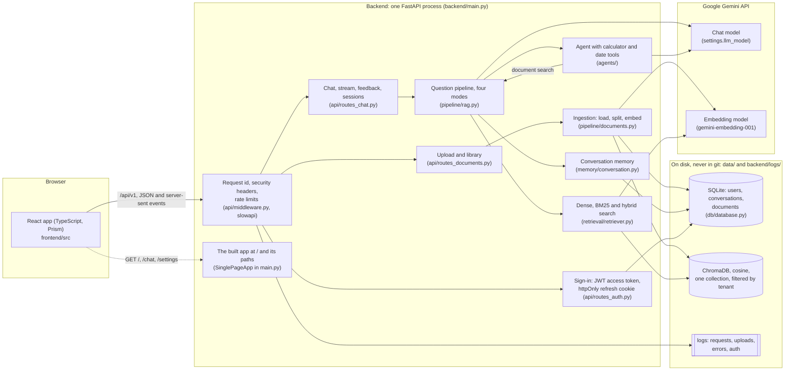

One process serves both the API and the built interface (`backend/main.py`; `tests/integration/test_frontend_serving.py`). Every setting is read in one place, `backend/src/core/config.py`, and a test fails if anything else reads the environment (`tests/test_no_orphans.py::test_only_core_config_reads_the_environment`). Each model id is written exactly once (`tests/test_no_orphans.py::test_each_model_id_is_written_in_exactly_one_place`).

### 2.2 Components

| Folder (`backend/src/`) | What it does | Tested by |
|---|---|---|
| `core/` | Settings, logging, password hashing and tokens | `tests/unit/test_startup.py`, `tests/integration/test_sign_in.py` |
| `api/` | The routes, request and reply models, errors, middleware | `tests/integration/test_api_routes.py`, `test_reply_models.py`, `test_exposure.py` |
| `ingestion/` | Reading each file type into text with page numbers | `tests/unit/test_parsers.py` |
| `chunking/` | Splitting text into overlapping passages; tables at row boundaries | `tests/unit/test_chunker.py` |
| `embeddings/`, `llm/` | Building the Gemini clients, with timeouts and retries | `tests/unit/test_model_factories.py`, `tests/unit/test_model_retries.py` |
| `vectordb/` | ChromaDB: add, search and delete, always for one tenant | `tests/unit/test_vector_store.py` |
| `retrieval/` | Dense search, BM25 keyword search, and their fusion | `tests/unit/test_search.py` |
| `prompts/` | Every prompt, written once | `tests/unit/test_prompts.py` |
| `pipeline/` | Ingestion end to end; the question pipeline in four modes | `tests/integration/test_documents.py`, `test_e2e.py`, `test_sources.py` |
| `agents/` | The tool-calling agent, the calculator and the date tool | `tests/integration/test_agent.py`, `tests/unit/test_calculator.py`, `test_datetime_tool.py` |
| `memory/` | Conversation history per user and session | `tests/integration/test_memory.py`, `tests/unit/test_conversation_memory.py` |
| `db/` | SQLite: users, conversations, documents | `tests/test_database.py` |
| `evaluation/` | The evaluation harness | `tests/unit/test_evaluation.py` |

| Folder (`frontend/src/`) | What it does | Tested by |
|---|---|---|
| `services/` | `api.ts`, the one client for the backend; `api-schema.ts`, its types, generated from the backend's schema; the sign-in state | `api.test.ts`, `api.contract.test.ts` |
| `components/` | The start page, the workspace (rail, conversation, composer), settings | `App.test.tsx`, `ChatLayout.test.tsx`, `rendering.test.tsx` |
| `design/` | Prism: tokens, components, the self-playing demo | `ChatLayout.test.tsx`, the journey |
| `../e2e/` | The browser journey with its accessibility checks | `npm run e2e`, in CI |

### 2.3 Requirements: the internship plan's 18 tasks

| Task | Where it is | Evidence |
|---|---|---|
| 1 Prompt templates | Every prompt once, as a template: `prompts/prompt_templates.py` | `tests/unit/test_prompts.py` |
| 2 Structured output | Pydantic models for every reply, published in the API schema | `tests/integration/test_reply_models.py`; `tests/test_openapi_snapshot.py` |
| 3 Sequential chain | Rewrite → retrieve → summarise → answer, composed with LCEL (the default mode) | `tests/integration/test_sources.py::test_by_default_the_answer_is_written_from_a_summary` |
| 4 Conversation memory | Last 10 turns per session, stored in SQLite (`memory_max_turns`) | `tests/integration/test_memory.py`; `test_agent.py::test_agent_sees_the_earlier_turns_of_the_session` |
| 5 Chat history UI | Thread list in the rail; one conversation per address (`/chat/:threadId`); survives a reload | `tests/integration/test_sessions.py`; `ChatLayout.test.tsx`; the journey |
| 6 Source attribution | File, page, similarity and passage; numbered citations in the text when answering from passages | `tests/integration/test_sources.py`; `ChatLayout.test.tsx` |
| 7 Confidence threshold | A question is refused when the best similarity is below the threshold, in every mode | `tests/unit/test_search.py::test_an_off_topic_question_is_refused_in_every_mode_without_asking_the_model` |
| 8 Prompt-injection protection | Passages wrapped in `<document>` tags they cannot close; file names escaped; the pattern list kept as telemetry | `tests/integration/test_injection_and_names.py` |
| 9 Calculator tool | An allow-list over Python's syntax tree; huge powers refused | `tests/unit/test_calculator.py` |
| 10 Date-time tool | Today, weekday, days between, add days: the arithmetic in Python | `tests/unit/test_datetime_tool.py`; `test_agent.py::test_agent_counts_days_with_the_tool_arguments_it_chooses` |
| 11 Agent decision layer | LangGraph tool-calling agent, chosen as a mode (see 2.5) | `tests/integration/test_agent.py` |
| 12 LangChain document loaders | PyPDFLoader, Docx2txtLoader, TextLoader, CSVLoader behind `AETHER_DOCUMENT_LOADER=langchain` | `tests/integration/test_documents.py::test_upload_with_the_langchain_loader_cites_pages_from_one` |
| 13 Text splitter | `RecursiveCharacterTextSplitter`, 1,000 characters, 150 overlap | `tests/unit/test_chunker.py` |
| 14 RetrievalQA chain | `langchain` mode: a LangChain retriever object (`UserRetriever`) and one LCEL chain | `tests/integration/test_langchain_mode.py`; `test_search.py::test_user_retriever_is_a_langchain_retriever_over_the_dense_search` |
| 15 LCEL refactor | Every chain is `prompt | model | parser` | `pipeline/rag.py`; `tests/integration/test_e2e.py` |
| 16 Logging | Four log files written and read back by tests | `tests/integration/test_api_routes.py` (log tests) |
| 17 Error handling | One message per failure; a server error gives a reference, not a traceback | `tests/integration/test_exposure.py::test_an_error_no_route_catches_is_json_with_a_reference_and_no_detail` |
| 18 Streaming | Server-sent events in every mode (the agent's after it has finished thinking) | `tests/integration/test_stream_closed.py`; `test_e2e.py` |

The plan also said "do not remove the current implementation" and "create a separate experimental branch". Neither was kept: the first audit found the NumPy store already removed and no repository at all (`AUDIT_REPORT.md`, section 5). Since Sprint 0 every change is on a branch and merged by pull request.

### 2.4 Requirements added beyond the plan

| Requirement | Why | Evidence |
|---|---|---|
| Accounts and sign-in | Documents are private; a shared server needs to know whose they are | `tests/integration/test_sign_in.py` (30 tests) |
| Tenant ids | A user id is reused after a database reset; a random tenant id is not (finding S2) | `tests/integration/test_tenants.py` |
| Hybrid search | Exact codes and names ("bearing 0420") are found by words better than by meaning | `tests/unit/test_search.py::test_hybrid_search_puts_the_chunk_both_methods_agree_on_first` |
| Answers written from passages, with citations | Shows which passage each sentence rests on (finding R5) | `tests/integration/test_sources.py::test_an_answer_from_chunks_lists_only_the_chunk_it_cites` |
| Background reading of uploads | A large file no longer holds the request open (R12) | `tests/integration/test_documents.py` |
| Rate and size limits | One user cannot exhaust the model quota or the disk (S4, S8) | `tests/integration/test_api_routes.py`, `test_upload_limits.py` |
| Feedback per answer | A thumbs-down marks an answer to look at | `tests/integration/test_feedback.py` |
| Evaluation harness | Quality claims need numbers (T3) | `tests/unit/test_evaluation.py` |
| Accessibility | The interface must work by keyboard, at phone width, in both themes | `frontend/e2e/journey.spec.ts` (axe) |

### 2.5 Design decisions and the alternatives rejected

| Decision | Rejected | Why | Evidence |
|---|---|---|---|
| ChromaDB, opened as a library inside the backend, with cosine distance | The earlier NumPy and JSON store; running Chroma as its own server | One collection filtered by tenant, persistent on disk, with no second process to run on Windows. The four advisories `pip-audit` reports for `chromadb` 1.5.9 are in its HTTP server, which this app never starts | `vectordb/vector_store.py`; `SPRINT_PLAN.md`, Sprint 5 item 11 |
| Hybrid search by reciprocal-rank fusion of dense and BM25 results, scored by similarity | Dense search only; BM25 only | Each finds what the other misses; the fused list keeps the cosine similarity, so one threshold works for both modes | `retrieval/retriever.py`; `tests/unit/test_search.py::test_fused_hits_are_scored_by_similarity_not_by_rank` |
| Confidence as cosine similarity, refusing below a threshold, in every mode | The earlier rank-based score in hybrid mode; letting the model decide | A refusal that needs no model call costs nothing and cannot be talked out of; one scale for every mode | `tests/unit/test_search.py::test_an_off_topic_question_is_refused_in_every_mode_without_asking_the_model` |
| The summary step stays the default; answering from numbered passages is a switch (`AETHER_ANSWER_FROM=chunks`) | Removing the summary step, which costs a model call | It is not yet measured which is better; a default should change on a measurement, not a guess (R4) | `SPRINT_PLAN.md`, Sprint 4 item 6; `tests/integration/test_sources.py` |
| Inline `[1]` citations in the answer text | A structured JSON answer listing its citations | A JSON answer cannot be streamed word by word | `SPRINT_PLAN.md`, Sprint 4 findings |
| Injection patterns logged, not removed; documents fenced in tags they cannot close | Cutting matched phrases out of the text | Two tests found the pattern list missed every paraphrased injection and corrupted ordinary sentences ("will act as a liaison") (S5) | `prompts/prompt_templates.py`; `tests/integration/test_injection_and_names.py::test_an_injected_chunk_reaches_the_model_unchanged_and_is_logged` |
| Text files read as UTF-8 (or UTF-16 with a byte-order mark); anything else refused with a message | Guessing the encoding | `charset-normalizer` read a Windows-1252 French sentence as UTF-16 Chinese characters | `SPRINT_PLAN.md`, Sprint 4 findings; `tests/unit/test_parsers.py` |
| The agent is one of four modes, chosen in the interface | The agent as the router for every question, as the plan's diagram draws it | It makes more model calls per question; the grounded pipeline should not depend on a model choosing to search | `AUDIT_REPORT_2.md`, section 5 (task 11) |
| Date arithmetic and calculation in Python tools | Letting the model work them out | A model counts days wrongly; a tool does not (R11) | `tests/unit/test_datetime_tool.py`, `tests/unit/test_calculator.py` |
| A short-lived access token kept in the page's memory, and a refresh token in an httpOnly cookie | One long-lived token in `localStorage` | A script injected into the page cannot read the refresh cookie; a reload still keeps the user signed in (S7) | `core/security.py`; `tests/integration/test_sign_in.py::test_login_sets_an_http_only_refresh_cookie_for_the_auth_routes_only` |
| Three model attempts with growing waits, the Google client's own retries off | The client's default of six retries | During a Gemini outage on 12 October 2026 the default held a request for about 60 s; now a long outage gives one clear message in under 2 s (single run, B10) | `core/config.py` (`llm_max_attempts`); `tests/integration/test_model_unavailable.py` |
| Uploads accepted at once and read in the background, with a status the interface follows | Reading the file inside the upload request | A large file held the request open for minutes (R12) | `tests/integration/test_documents.py::test_an_upload_is_accepted_at_once_and_read_after_the_reply` |
| Typed interface: TypeScript types generated from the backend's OpenAPI schema, checked in CI | Hand-written types or none | A field renamed on one side fails the build on the other; the cause of findings B7 and F4 | `frontend/src/services/api-schema.ts`; `api.contract.test.ts`; `npm run api-types -- --check` |
| Server-sent events over `fetch` for streaming | WebSockets | One request per answer, through the same authentication and rate limits as every other route; the backend cancels the answer when the browser closes the stream | `api/routes_chat.py`; `tests/integration/test_stream_closed.py` |
| A design language of the project's own (Prism), one font, tokens in CSS | A UI kit | A look of its own, and one set of rules every screen follows | `DESIGN.md`; `frontend/src/design/` |

---

## Chapter 3: Software and Hardware Requirements

### 3.1 Software

| Item | Version | Where it is set |
|---|---|---|
| Python | 3.12 | `backend/requirements.txt` (tested together on 3.12); CI |
| FastAPI, Starlette, Uvicorn | 0.133.1, 1.3.1, 0.35.0 | `backend/requirements.txt` |
| LangChain, LangChain core, LangGraph | 1.3.11, 1.4.8, 1.2.6 | `backend/requirements.txt` |
| LangChain Google GenAI | 4.2.6 | `backend/requirements.txt` |
| ChromaDB | 1.5.9 | `backend/requirements.txt` |
| pypdf, python-docx, pandas, openpyxl, xlrd | 6.20.0, 1.2.0, 2.2.3, 3.1.5, 2.0.1 | `backend/requirements.txt` |
| rank-bm25 | 0.2.2 | `backend/requirements.txt` |
| bcrypt, PyJWT, slowapi | 5.0.0, 2.15.0, 0.1.9 | `backend/requirements.txt` |
| Node.js | 20.19+ or 22.12+ (CI uses 24) | `README.md`; `.github/workflows/ci.yml` |
| React, React Router, react-markdown | 19.2, 7.18, 10.1 | `frontend/package.json` |
| TypeScript, Vite, Vitest, oxlint | 5.9, 8.1, 5.0, 1.71 | `frontend/package.json` |
| Playwright, axe for Playwright | 1.56.1, 4.13 | `frontend/package.json` |
| Gemini chat model | `gemini-3.5-flash` (`AETHER_LLM_MODEL`) | `core/config.py` |
| Gemini embedding model | `models/gemini-embedding-001`, 3,072 dimensions | `core/config.py`; `SPRINT_PLAN.md`, Sprints 0 and 1 |

A Google API key is needed only to answer real questions. The tests use fake models (`backend/tests/fakes.py`) and need no key and no network.

### 3.2 Hardware

The application runs as one process on one machine. It was developed and checked on the author's Windows laptop (`SPRINT_PLAN.md`, the "on the owner's Windows machine" entries) and in Linux cloud sessions. [OWNER: the laptop's processor, memory and Windows version]

The model work happens at Google, so the server needs no GPU. Disk use is the uploaded documents' passages and vectors in `data/`, limited to 100 documents per user and 5,000 passages per document (`core/config.py`).

---

## Chapter 4: Major Functionality

### 4.1 Reading a document

1. **Checks before reading.** The upload needs a valid token before its body is read; it is streamed to disk and cut off at 50 MB; a Word or Excel file that would unpack to more than 200 MB is refused before it is parsed; a table may have at most 100,000 rows (`tests/integration/test_upload_limits.py`, 12 tests).
2. **Duplicates and replacements.** A file with the same contents as one already stored is refused; a changed file with the same name replaces the earlier one, and if the replacement fails the earlier file is kept (`tests/integration/test_documents.py::test_uploading_a_changed_file_of_the_same_name_replaces_it`, `::test_a_replacement_that_fails_keeps_the_earlier_file`).
3. **Reading.** PDF pages, Word paragraphs and tables, text and Markdown, and CSV and Excel rows (50 rows per block, each row written as "Column: value") become text with page numbers from 1 (`ingestion/loader.py`; `tests/unit/test_parsers.py`).
4. **Splitting.** Prose is cut at paragraphs, then lines, then sentences; tables at rows, never inside a "Column: value" (`chunking/chunker.py`; `tests/unit/test_chunker.py`).
5. **Storing.** Each passage carries its tenant, its document's id, file name, page and position (`tests/integration/test_documents.py::test_every_chunk_carries_its_document_s_id`).
6. **Status.** Each document is processing, ready, or failed with the reason, and the library shows it (`api/schemas.py`, `DocumentStatus`; `tests/integration/test_documents.py::test_an_upload_is_accepted_at_once_and_read_after_the_reply`; `ChatLayout.test.tsx`). A document removed while it is still being read leaves nothing searchable (`::test_a_document_removed_while_it_is_read_leaves_nothing_behind`, finding N2), and a reading cut short by a restart is marked failed and its passages removed (`::test_an_upload_a_restart_cut_short_is_marked_failed_and_its_chunks_removed`).

### 4.2 Answering a question

```text
question ─► rewrite (only when there is history) ─► search (top 5) ─► refuse? ─► summarise ─► answer ─► save turn
                                                                         │         (or answer from numbered passages)
                                                                         └─► "I could not find relevant information…", no sources
```

- **Rewrite.** A follow-up such as "and who does that?" is rewritten with the conversation so far into a question that can be searched on its own (`retrieval/retriever.py::rewrite_question`).
- **Search.** Five passages (`top_k`) of the user's own documents, by meaning (dense), or by meaning and words together (hybrid) (`tests/unit/test_search.py`, 30 tests).
- **Refusal.** When the best passage's similarity is below the threshold (0.3, `confidence_threshold`), the answer is a fixed refusal with no sources, and no model is asked. The confidence shown is the mean similarity of the passages (`pipeline/rag.py::events`).
- **Answer.** The model writes the answer from a summary of the passages (the default), or from the numbered passages, citing them as [1], [2], in which case the sources are exactly the passages cited (`tests/integration/test_sources.py`, 21 tests).
- **Streaming.** The answer arrives word by word as server-sent events: `token` events, then one `done` event with the sources, confidence and the saved turn's id, or one `error` event (`api/schemas.py`, `StreamEvent`). Stop closes the stream: the server stops, saves nothing, and the question goes back into the box (`tests/integration/test_stream_closed.py`; `ChatLayout.test.tsx`).
- **Four modes**, chosen in the composer: *default*, *hybrid*, *langchain* (the same pipeline built from LangChain's retriever and one LCEL chain, Tasks 14 and 15), and *agent* (4.3). All four answer in the end-to-end test (`tests/integration/test_e2e.py`).

### 4.3 The agent

In agent mode a LangGraph tool-calling agent chooses among three tools: a search of the user's documents (which runs the pipeline above), a calculator and a date tool. It may chain them, for example to count the days from a date found in a document to today. It is told never to answer from its own knowledge, has at most 12 steps (`agent_recursion_limit`), and an answer that searched no document carries no confidence. The interface lists the tools used under the answer (`tests/integration/test_agent.py`, 9 tests; `ChatLayout.test.tsx`).

### 4.4 Conversations and feedback

Each conversation has its own address (`/chat/:threadId`). The rail lists the most recent 50, titled by their first question; a reload brings back the conversation with its sources, confidence and mode (`tests/integration/test_sessions.py`). Each answer can be rated helpful or not helpful, stored against its turn (`tests/integration/test_feedback.py`). At most 1,000 conversations are kept in memory; the rest are read from SQLite when needed (`tests/unit/test_conversation_memory.py::test_the_cache_keeps_only_the_most_recently_used_sessions`).

### 4.5 The interface

| Path | What it shows |
|---|---|
| `/` | The start page, with a self-playing demonstration of an answer with sources |
| `/login` | The start page with the sign-in sheet |
| `/chat`, `/chat/:threadId` | The workspace: rail (conversations, library, upload), conversation, composer |
| `/settings` | The workspace with the settings sheet: clearing the conversation, the library, the backend's state and the version |

The routes are tested in `src/App.test.tsx`; the backend serves `index.html` at each of them and keeps `/api/...` and the API pages as real 404s (`tests/integration/test_frontend_serving.py`). Every screen uses the Prism tokens and components (`DESIGN.md`; `frontend/src/design/`), in a light and a dark theme chosen in the header. The journey checks that the layout fits from 360 px wide with no sideways scroll, that axe finds no violation at 1280 and 375 px, and that settings can be opened and closed by keyboard (`frontend/e2e/journey.spec.ts`). A dialog makes the page behind it inert (`Dialog` in `src/design/prism.tsx`), and animation stops when the system asks for reduced motion (`src/design/prism.css`); neither has a test of its own.

### 4.6 Errors and logs

| Situation | What the person sees | Evidence |
|---|---|---|
| The model is busy or over quota | One message after a short retry; nothing saved | `tests/integration/test_model_unavailable.py` |
| Too many requests | "Too many requests. Please wait N seconds and try again.", with `Retry-After` | `tests/integration/test_api_routes.py` (N1); `src/services/api.test.ts` |
| An unreadable file | The reason, with no server path | `tests/unit/test_parsers.py` |
| An unexpected server error | A reference to quote, matched to the log by request id; no traceback | `tests/integration/test_exposure.py` |
| The session expired | Signed out with the reason | `src/App.test.tsx` |
| A failed answer | The error under the question, and Retry | `ChatLayout.test.tsx` |

Four logs are written as one JSON object per line: `requests.log` (each question, mode, confidence and timing), `uploads.log`, `errors.log` and `auth.log` (sign-ups, sign-ins and failures, never passwords) (`core/logging.py`; `tests/integration/test_api_routes.py`; `test_sign_in.py::test_sign_ups_sign_ins_and_failures_are_logged_without_passwords`).

---

## Chapter 5: Flow Charts

### 5.1 Reading an upload

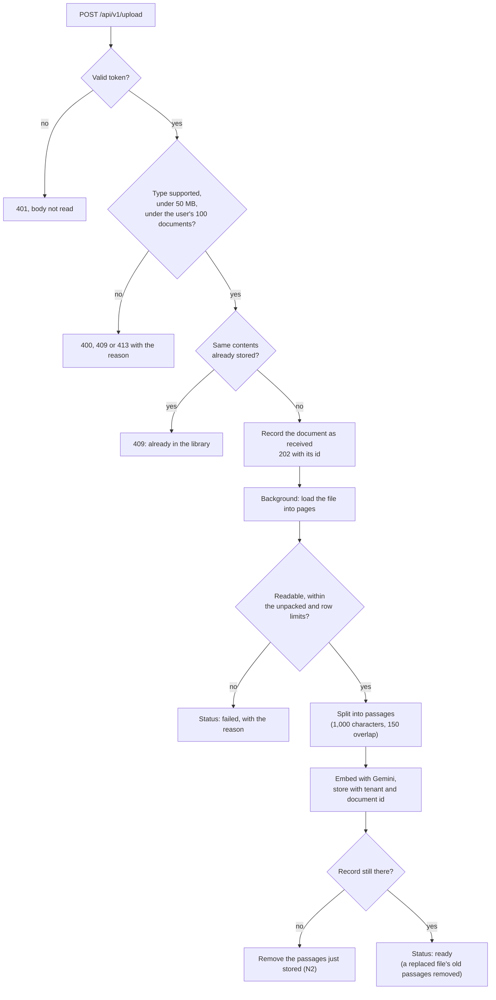

### 5.2 Asking a question (streamed)

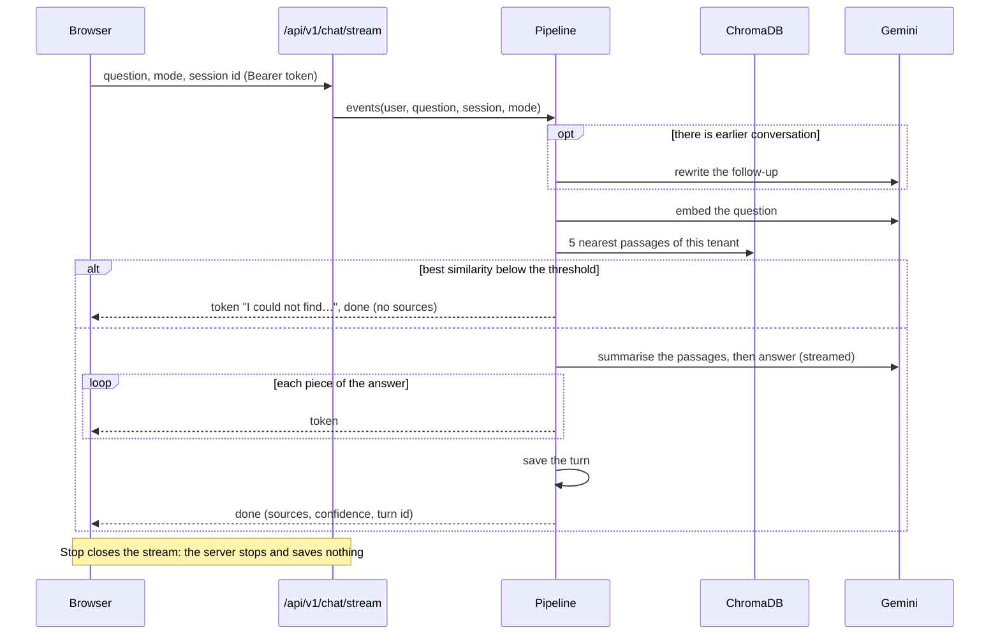

### 5.3 Signing in and staying signed in

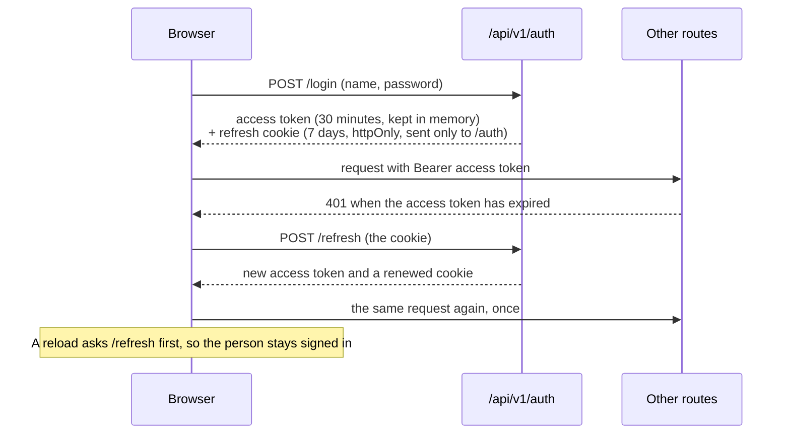

The renewal and the single retry are tested in `src/services/api.test.ts`; the cookie in `tests/integration/test_sign_in.py`.

---

## Chapter 6: Security Model

### 6.1 What is protected, and from whom

- **Assets:** each user's documents, passages, conversations and feedback; the accounts; the Gemini key and its quota.
- **Who might misuse them:** another user of the same server; someone on the office network without an account; a document whose text tries to instruct the model.
- **Trusted:** the machine the server runs on, and the person who runs it. The data in `data/` is not encrypted at rest.

### 6.2 Controls

| Threat | Control | Evidence |
|---|---|---|
| One user reads, searches or deletes another's data | Every query is filtered by the tenant id from the signed token; another user's document id is a 404 | `tests/integration/test_tenant_isolation.py` (both directions, every store); `test_tenants.py`; `test_sessions.py::test_another_user_s_sessions_are_neither_listed_nor_readable`; `test_documents.py::test_another_user_s_document_cannot_be_deleted` |
| A database reset gives an old token to a new user with the same id | Tokens carry the tenant id; a token whose tenant does not match is refused | `tests/integration/test_sign_in.py::test_a_token_from_before_a_database_reset_does_not_sign_in_the_new_owner_of_its_id` |
| Password theft from the database | bcrypt hashes; 8 characters to 72 bytes | `tests/integration/test_sign_in.py::test_password_length_is_8_characters_to_72_bytes` |
| Finding which names have accounts | A sign-in for an unknown name still checks a password, so it takes as long | `::test_a_login_for_an_unknown_name_still_checks_a_password` |
| A script in the page steals the session, or another site uses it | The refresh token is in an httpOnly, `SameSite=Strict` cookie, sent only to `/api/v1/auth`; the access token lasts 30 minutes and lives in the page's memory | `::test_login_sets_an_http_only_refresh_cookie_for_the_auth_routes_only`, `::test_access_tokens_last_30_minutes`; `api/routes_auth.py` |
| Strangers create accounts | `AETHER_INVITE_CODE`: registration needs the code once one is set | `::test_registration_needs_the_invite_code_once_one_is_set` |
| A model's answer loads a remote image that carries data away, or injects a script | Answers are rendered as Markdown with no images and no raw HTML; links open in a new tab with `noopener noreferrer`; the content-security policy allows no remote script, style or image | `ChatLayout.test.tsx` (S3); `tests/integration/test_exposure.py::test_the_policy_allows_no_remote_script_style_or_image` |
| A document instructs the model | Passages are fenced in `<document>` tags they cannot close, file names are escaped, the prompts say to treat them as data, matches are logged; the agent's only tools are the document search, the calculator and the date tool, none of which reaches the network or the file system | `tests/integration/test_injection_and_names.py`; `agents/tools.py`; `tests/unit/test_calculator.py::test_anything_but_plain_math_is_refused` |
| Exhausting the quota, the disk or the memory | Per-user rate limits on every route (chat 30 a minute, upload 10, login 10, register 5); size, unpacked-size, row, passage and document limits | `tests/integration/test_api_routes.py::test_every_api_route_has_a_limit`; `test_upload_limits.py` |
| Errors that reveal the server | A server error gives a reference, not a traceback; no path in a file error; the API pages off in production | `tests/integration/test_exposure.py` |
| Clickjacking and sniffing | `X-Frame-Options: DENY`, `frame-ancestors 'none'`, `nosniff`, `no-referrer` on every response | `::test_every_response_carries_a_request_id_and_the_security_headers` |
| A secret in the repository | `.gitignore` keeps `.env`, `data/`, logs and the old store paths out; the backend refuses to start without `JWT_SECRET` | `.gitignore`; `tests/unit/test_startup.py::test_backend_refuses_to_start_without_jwt_secret` |
| Vulnerable dependencies | `pip-audit` and `npm audit` | `npm audit`: 0. `pip-audit`: four advisories in `chromadb` 1.5.9, all in its HTTP server, which this app does not run, and no newer release to move to (`SPRINT_PLAN.md`, Sprint 5 item 11) |

### 6.3 Known gaps

- **A refresh token is not revoked on the server.** Signing out removes the cookie, but a stolen refresh cookie would work until it expires, up to 7 days (`AUDIT_REPORT_2.md`, N5). Planned in Sprint 8, item 4.
- **Plain HTTP.** On the office network the cookie and the tokens travel unencrypted. `AETHER_COOKIE_SECURE` should be turned on once the app is served over HTTPS (`docs/demo-checklist.md`).
- **Two settings must be set before others can reach the server:** `AETHER_INVITE_CODE` and `AETHER_ENVIRONMENT=production`. Their defaults keep the author's own setup working (`README.md`, "Running it where other people can reach it").
- **Which documents may be sent to the Gemini API** on which tier is not yet agreed with the mentor (finding S11). [OWNER: the documents allowed, and the API tier, agreed with the mentor]
- Rate-limit counts start again at a restart (N9). Times are stored as the server's local time (N6).

---

## Chapter 7: Testing and Evaluation

### 7.1 Tests

| Suite | Count | What it shows | Command |
|---|---|---|---|
| Backend | 587 tests, 99% line coverage | Every route, both directions of tenant isolation, every mode end to end, every limit and failure | `cd backend && python -m pytest` |
| Interface | 82 tests | The router, the API client, the chat (streaming, stop, retry, citations, feedback, threads, upload stages), rendering cost | `cd frontend && npm test` |
| Browser journey | 1 test | The start page, sign up, upload, ask and see the sources, reload, rate, a second thread and back, settings, remove a document, sign out, in Chromium against the real backend with fake models; axe accessibility checks at 1280 and 375 px; no sideways scroll at 375 and 360 px; settings by keyboard | `cd frontend && npm run e2e` |

The counts are those of Sprint 7 (`SPRINT_PLAN.md`, Sprint 7 evidence). No test calls Google: the models are replaced by fakes that answer from the passages they are given (`backend/tests/fakes.py`), and every test uses a temporary database, vector store and log folder (`backend/tests/conftest.py`). Continuous integration runs all three on every push, together with `ruff`, the type checks, the build and a check that the generated API types match the schema (`.github/workflows/ci.yml`); it fails if coverage drops below 70%.

Three checks keep the parts connected (`SPRINT_PLAN.md`, "The connection rule"):

1. **An end-to-end test** registers, signs in, uploads, asks in every mode, reads the history and deletes (`tests/integration/test_e2e.py::test_end_to_end`).
2. **A schema snapshot and generated types.** The backend's OpenAPI schema is compared with `tests/openapi_snapshot.json`; the interface's types are generated from that snapshot, and a contract test checks every client call against it (`tests/test_openapi_snapshot.py`; `frontend/src/services/api.contract.test.ts`).
3. **A no-orphan check** fails if a module is imported by nothing, a route is called by no test, or anything but `core/config.py` reads the environment (`tests/test_no_orphans.py`).

Whether the tests can fail was checked, not assumed: with the tenant filter removed from the dense search, 14 tests failed; with an earlier LangChain fix reverted, 10 did (`SPRINT_PLAN.md`, Sprint 2 evidence).

### 7.2 Evaluation method

The harness `backend/src/evaluation/evaluate.py` measures the real pipeline, not a copy of it (`tests/unit/test_evaluation.py::test_run_asks_the_real_pipeline_and_scores_it`):

1. It reads a dataset, one JSON object per line: an answerable question names its expected answer, its file, and its page or a phrase the right passage must contain; an unanswerable question says `"answerable": false`.
2. It reads the dataset's documents through the app's own ingestion into a temporary store, so the real database and vector store are never opened.
3. It asks every question through `pipeline/rag.py`, once per mode (default and hybrid), and scores the answers.
4. It saves the run as `docs/evaluation/<label>.json` and rebuilds `docs/evaluation.md` from every saved run, so runs can be compared side by side.

`--retrieval-only` measures retrieval and the threshold with embedding calls only, no answers. A line that cannot be read, a missing document or a judge reply that cannot be parsed stops the run: no score is ever filled in.

How each number is computed (from `REPORT_NOTES` in `evaluate.py`):

| Measure | Definition |
|---|---|
| hit@k | The share of answerable questions for which at least one of the top k passages is a right one: from the named file, on a named page if any, containing the named phrase if any. k is the app's `top_k` (5) |
| MRR | For each answerable question, 1 divided by the position of the first right passage (0 when none is retrieved), averaged |
| Unanswerable refused | The share of unanswerable questions the app declined. Higher is better |
| Answerable refused | The share of answerable questions the app declined anyway. Lower is better |
| Correctness | A judge model compares each answer with the expected one: 1 (every fact), 0.5 (some) or 0 (none, wrong or declined); averaged over the answerable questions |
| Faithfulness | The judge reads the retrieved passages and the answer and gives the share of the answer's claims they support; averaged over the answered questions |
| Judge | A different model from the one that answers (`AETHER_JUDGE_MODEL` has no default, so the run cannot score itself) |
| Seconds, tokens | The median seconds per question for each stage; the mean tokens in and out per question, as the model reports them |
| Suggested threshold | Every cut between neighbouring best-passage scores is tried; the suggestion puts the most questions on the right side (answerable at or above, unanswerable below) |

### 7.3 Observations so far

These were recorded during development on the author's machine with the real Gemini key. **Each is from a single run, on a handful of questions, and is not a measurement of the system's quality.**

| Observation | Value | Where recorded |
|---|---|---|
| Similarity of an unrelated question | 0.50 (first run); 0.55 against two small documents (second run) | `SPRINT_PLAN.md`, Sprints 0 and 1; Sprint 4 findings |
| Similarity of answerable questions | 0.67 to 0.80 (first run); 0.71 to 0.78 (second run) | same |
| What that means for the threshold | The default 0.3 refused nothing in either run; the first run suggested a cut near 0.6, to be set by the harness | same |
| Time per answer, default mode | About 23 s per answer and 27 s to the first streamed token, from two model calls in sequence | `SPRINT_PLAN.md`, Sprints 0 and 1 |
| Answer from passages against answer through the summary | 18 s against 57 s on the same afternoon, while Gemini was returning 503 errors, so not a comparison | `SPRINT_PLAN.md`, Sprint 4 findings |
| Similarity in dense and hybrid mode on a table and a CSV | The same in both (0.71 and 0.61) | `SPRINT_PLAN.md`, Sprint 4 |
| An upload ready to search | 4 s for one small file | `SPRINT_PLAN.md`, Sprint 5 |
| A long Gemini outage | One clear message in under 2 s, where it had taken about 60 s | `SPRINT_PLAN.md`, Sprint 5 item 10 |

### 7.4 Results

To be filled from `docs/evaluation.md`.

| Measure | default | hybrid |
|---|---|---|
| Questions (answerable + unanswerable) | | |
| hit@5 | | |
| MRR | | |
| Unanswerable refused | | |
| Answerable refused | | |
| Correctness | | |
| Faithfulness | | |
| Seconds per question (median), by stage | | |
| Tokens in / out per question (mean) | | |
| Suggested threshold | | |

The dataset (3 to 5 documents that may be shared, and 30 to 50 labelled questions) has not been written, so the harness has not been run. Until it is, the threshold stays at the uncalibrated 0.3 and the summary step stays the default (`SPRINT_PLAN.md`, Sprint 4 items 1, 3, 4 and 6). [OWNER: the dataset, then the results of `python -m src.evaluation.evaluate --label baseline`]

---

## Chapter 8: Screenshots of Project Output

The screenshots below were taken with Playwright against the backend running fake models and test documents, so that no real data and no model's answer appears in them (`SPRINT_PLAN.md`, Sprint 7 decision 5). Desktop screenshots are 1280 × 800, phone screenshots 375 × 812. Screens that show an answer are to be taken on the author's machine with real answers.

### 8.1 The start page

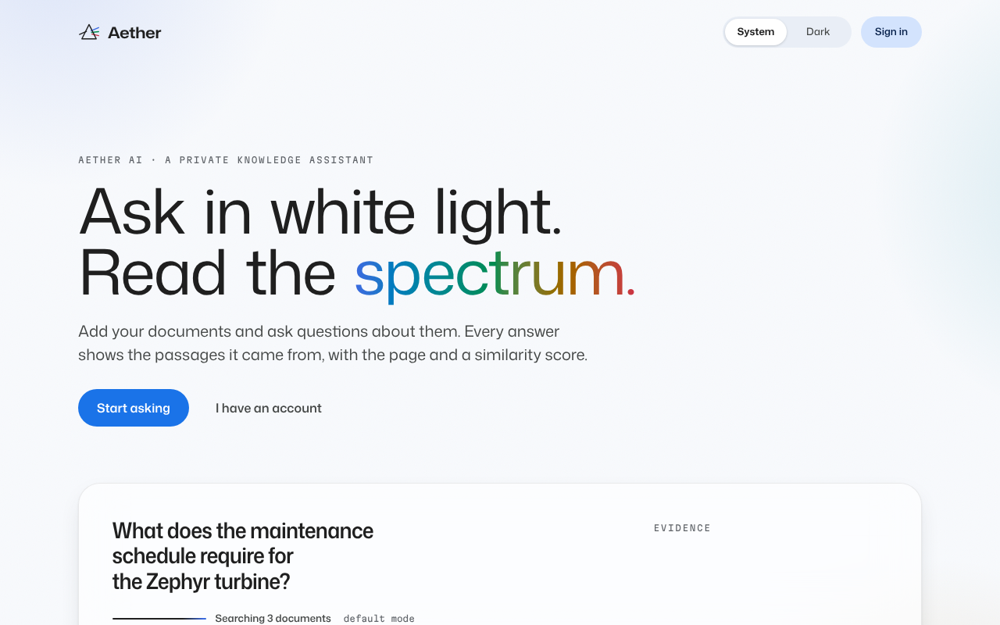

*The start page in the light theme. The bench on the right plays a demonstration of an answer with its sources.*

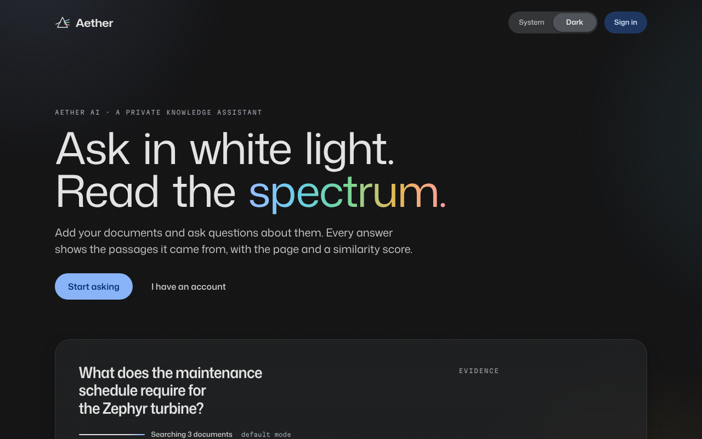

*The same page in the dark theme.*

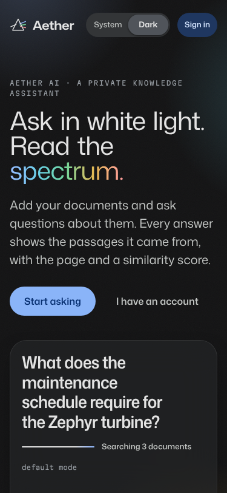

*At phone width the page stacks into one column.*

### 8.2 Signing in

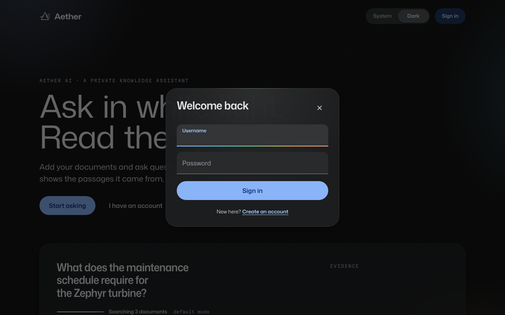

*The sign-in sheet (`/login`). The page behind it is inert until the sheet is closed.*

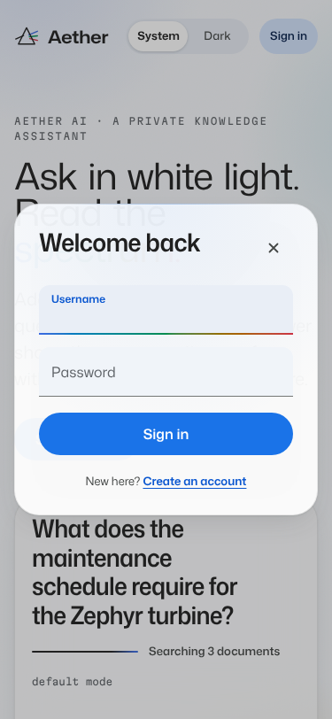

*The sign-in sheet at phone width.*

### 8.3 The workspace: conversations and library

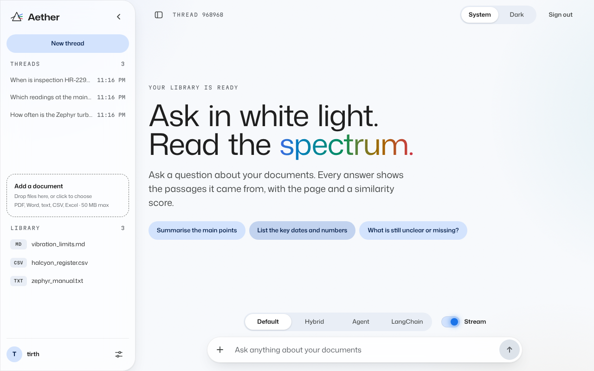

*The workspace with three earlier conversations in the rail, three documents in the library, and a new conversation open.*

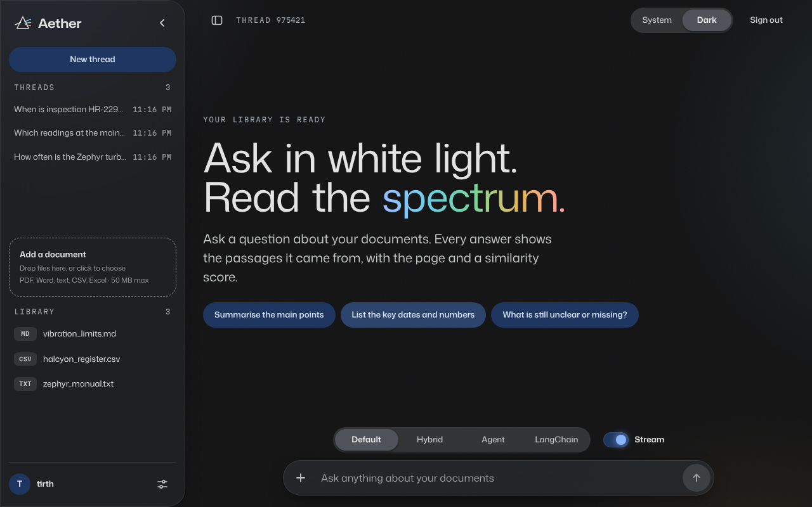

*The same in the dark theme.*

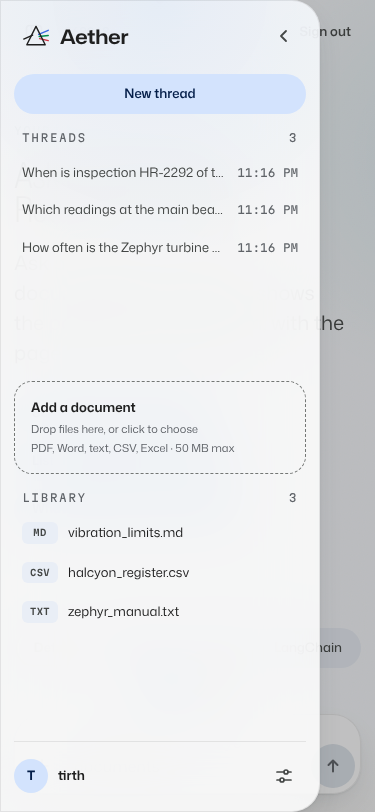

*The library at phone width.*

### 8.4 Settings

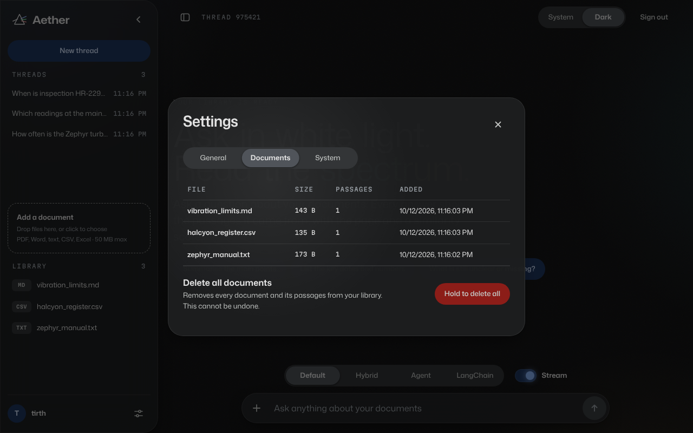

*Settings, Documents tab: each file with its size, passages and the time it was added. Deleting the whole library takes a held press. The System tab shows the backend's state and the version (2.0.0).*

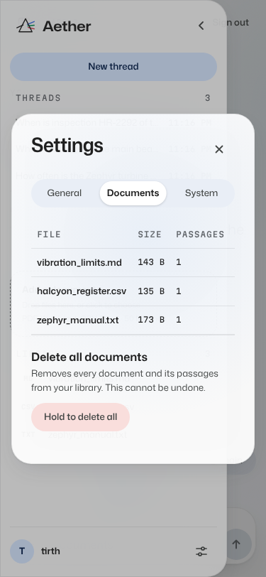

*Settings at phone width, as a sheet over the workspace.*

### 8.5 Answers (to be taken with real answers)

- [OWNER: screenshot of a factual answer with its numbered citations and an open source card]
- [OWNER: screenshot of a follow-up question answered from the conversation]
- [OWNER: screenshot of a refusal for a question the documents cannot answer]
- [OWNER: screenshot of an agent answer with its "Tools used" row]
- [OWNER: screenshot of an answer being streamed, with the Stop control]
- [OWNER: screenshot of an upload being read, then ready, in the library]

---

## Chapter 9: Limitations of Project

1. **Answer quality is not measured.** There is no labelled dataset yet, so hit@5, MRR, correctness and faithfulness are unknown, the refusal threshold is uncalibrated (0.3 refused no unrelated question in two single runs, 7.3), and whether the summary step helps is unknown (`AUDIT_REPORT_2.md`, section 1).
2. **Answers are slow.** About 23 s per answer in the one timed run, from two model calls in sequence (7.3).
3. **It depends on one external API.** Without Gemini there are no answers and no uploads; quota and outages give a clear message but no answer (`tests/integration/test_model_unavailable.py`).
4. **No OCR.** Scanned PDFs and images give no text.
5. **One process, one machine.** Rate-limit counts are in memory and start again at a restart (N9); Docker is deferred (D4).
6. **Security gaps** listed in 6.3: refresh tokens not revoked on the server (N5), plain HTTP, two settings to set before the server is shared, and the data question (S11).
7. **Smaller known issues**, each written down with its reason in `AUDIT_REPORT_2.md`, section 6: times stored as local time (N6); two identical uploads at the same moment can both pass the duplicate check (N7); the rail lists 50 conversations (N8); conversations are deleted through a route that takes a whole chat request (N10); a buffering proxy would hold back the stream (N11).
8. **Not checked:** the browser journey on Windows from a folder whose path has spaces, a pass with a real screen reader, and the office network with its certificate (`AUDIT_REPORT_2.md`, section 9).

---

## Chapter 10: Outcome

### 10.1 What was achieved

| Outcome | Evidence |
|---|---|
| All 18 tasks of the internship plan are in the code, each with a test | Section 2.3; `AUDIT_REPORT_2.md`, section 5 |
| Of the first audit's 64 findings, 50 are fixed, 12 partly fixed or changed, and 2 open (S11, D4) | `AUDIT_REPORT_2.md`, section 1 |
| Real questions answered with page citations on the author's machine | `SPRINT_PLAN.md`, Sprints 0 and 1, 3, 4 and 5 (single runs) |
| Separate accounts, proved in both directions for every store and route | `tests/integration/test_tenant_isolation.py`, `test_tenants.py` |
| 587 backend tests at 99% coverage, 82 interface tests and a browser journey, all without a model key | Chapter 7 |
| An accessible interface: axe checks at two widths in CI, Lighthouse accessibility 100 on mobile and desktop (single run) | `frontend/e2e/journey.spec.ts`; `SPRINT_PLAN.md`, Sprint 6 |
| A harness ready to measure quality | `tests/unit/test_evaluation.py` |
| A checklist for demonstrating it on the office network | `docs/demo-checklist.md` |

### 10.2 What was learned

- **Retrieval-augmented generation** in practice: the answer is only as good as the passages found, and a threshold set without data does nothing (7.3).
- **Semantic and keyword search**, and fusing them by rank while keeping one score scale (`retrieval/retriever.py`).
- **LangChain and LangGraph**: LCEL chains, retrievers, document loaders and a tool-calling agent.
- **FastAPI**: dependency-injected authentication, streaming responses, background tasks, an OpenAPI schema that the interface's types are generated from.
- **Security for a shared server**: tenant isolation, token design, limits, headers and a content-security policy, and writing down what is still open.
- **React with TypeScript**: routing, streaming state, memoised rendering, accessibility.
- **Testing as evidence**: fakes for external services, end-to-end tests, a browser journey, and checking that a test can fail before trusting that it passes.
- **Working in reviewed steps**: one branch and pull request per sprint, with the evidence recorded in `SPRINT_PLAN.md`.

---

## Chapter 11: Future Enhancement

Planned next, in `SPRINT_PLAN.md`, Sprint 8:

1. **What an answer cost**: each stage's seconds and tokens with every answer, and in the log.
2. **A tool trace for agent answers**: the steps in order, shown above the answer.
3. **Renaming and deleting a conversation** (also closes N10).
4. **Sign out everywhere**: refresh tokens recorded and revocable on the server (closes N5).
5. **Thumbs-down answers exported** as candidate questions for the evaluation dataset.
6. **A housekeeping command** that reports and, when asked, removes passages no document accounts for.

After that:

7. **Measure, then calibrate**: write the dataset, run the baseline, set the threshold from it, and decide whether the summary step stays (`SPRINT_PLAN.md`, Sprint 4 items 1, 3, 4 and 6).
8. **Docker**: one image with the built interface, a non-root user and a health check, and the journey run against it in CI (Sprint 7 items 1 and 2, deferred).
9. **HTTPS** on the office server, then the secure cookie.
10. **OCR** for scanned PDFs.
11. **Paging** in the conversation list (N8) and times stored with their time zone (N6).

---

## Chapter 12: References

1. Lewis, P. et al. (2020). "Retrieval-Augmented Generation for Knowledge-Intensive NLP Tasks." *Advances in Neural Information Processing Systems 33.* https://arxiv.org/abs/2005.11401
2. Robertson, S. and Zaragoza, H. (2009). "The Probabilistic Relevance Framework: BM25 and Beyond." *Foundations and Trends in Information Retrieval* 3(4).
3. Cormack, G. V., Clarke, C. L. A. and Büttcher, S. (2009). "Reciprocal Rank Fusion Outperforms Condorcet and Individual Rank Learning Methods." *Proceedings of SIGIR 2009.*
4. LangChain documentation: https://python.langchain.com/docs/
5. LangGraph documentation: https://langchain-ai.github.io/langgraph/
6. Google Gemini API documentation, embeddings: https://ai.google.dev/gemini-api/docs/embeddings
7. ChromaDB documentation: https://docs.trychroma.com/
8. FastAPI documentation: https://fastapi.tiangolo.com/
9. React documentation: https://react.dev/
10. Playwright documentation: https://playwright.dev/
11. axe-core accessibility rules: https://github.com/dequelabs/axe-core
12. OWASP Top 10 for Large Language Model Applications: https://owasp.org/www-project-top-10-for-large-language-model-applications/
13. The project's own records: `AUDIT_REPORT.md`, `AUDIT_REPORT_2.md`, `SPRINT_PLAN.md`, `DESIGN.md`, `README.md`.

---

## Facts still to be filled in by the author

| Where | What is needed |
|---|---|
| Front matter | The department or team at Netweb Software |
| Front matter | The industry mentor's name and title |
| Front matter | The first and last day of the internship |
| 3.2 | The laptop's processor, memory and Windows version |
| 6.3 | The documents allowed, and the API tier, agreed with the mentor (S11) |
| 7.4 | The dataset, then the results of the baseline run |
| 8.5 | Six screenshots with real answers: a cited answer with an open source card, a follow-up, a refusal, an agent answer, a streamed answer with Stop, an upload being read |
